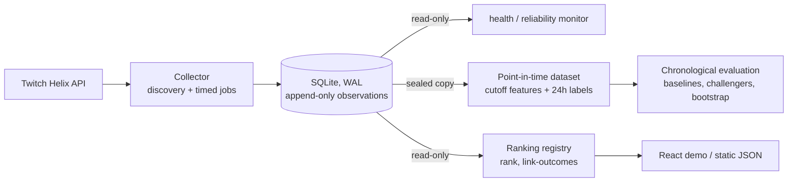

# ViralClip Radar

ViralClip Radar asks one question: **using only what is known in a clip's first
hour, can you tell which Twitch clips will be the most viewed at 24 hours?**

Twitch keeps no view history for clips, so the answer cannot be studied from a
public dataset. The project therefore built the dataset prospectively: a
collector that discovers new clips and re-measures each one at fixed ages,
storing every view count with its real UTC timestamp. On top of it sits a
leakage-safe research pipeline (point-in-time features, chronological splits,
embargoed labels, pre-declared baselines and challengers) and a small ranking
demo.

## Project status: closed

Collection ran 24/7 from November 17 to November 26, 2026 on a Linux VPS,
with GTA V and GTA VI as separate services. Before using the data for
research, I asked Twitch for written permission. On November 26, 2026 Twitch
declined research use of the data. I stopped both collectors the same day
and deleted every collected database, copy, export and HTTP log.

As a result, **this repository reports no model results on real data**.
Everything below that produces numbers runs on labeled synthetic data, which
validates the mechanics, not predictive performance.

| Implemented and tested (synthetic data, mocked HTTP) | Never measured on real data |
| --- | --- |
| Collector, scheduling, retries, rate-limit handling, storage invariants | Whether any baseline or model ranks real clips better than `latest_views` |
| Point-in-time export, label windows, cohort audit, chronological splits and embargo | Ranking metrics, uncertainty intervals and lift on real cohorts |
| Four baselines, the c1 challenger and the c2 model comparison (ridge, XGBoost, LightGBM, MLP) | Feature importance, calibration and creator holdout on real data |
| Ranking registry, outcome linking, static publishing, FastAPI API and React dashboard | Live rankings of real clips |
| Operational tooling, run in production for ten days (health, reliability monitor, 48-hour journal check) | Reboot rehearsal and cold-start recovery |

## What was built

| Area | What it does |
| --- | --- |
| Collector | Official Helix API, OAuth app token, popularity-ordered discovery with overlapping UTC minute windows, persistent idempotent re-measurement jobs at 10 min, 30 min, 60 min, 6 h and 24 h, batches of 100, bounded retries, 401 and 429 handling, JSONL HTTP telemetry |
| Storage | SQLite with WAL, foreign keys, one OS-locked writer per database, additive migrations, append-only observations; missing, unavailable and late kept distinct from zero views |
| Operations | Two systemd services on Ubuntu with separate accounts, databases and locks; boot enablement; five-minute read-only reliability monitor; read-only `health` command with HEALTHY, DEGRADED and CRITICAL rules; online backup, manifest and isolated restore tooling; passed a paired 48-hour journal check with no unexplained gaps |
| Point-in-time dataset | Features only from observations taken at or before the cutoff (30, 35, 60 or 65 min); 24-hour label window of 86,400 to 86,700 s; immature, unavailable and censored outcomes stay explicit |
| Evaluation | Chronological train, validation and test days with a 24h + 5 min embargo; per-day cohort audit; four baselines; day-level bootstrap with paired differences; analytic random and ideal references; frozen protocols so results stay reproducible |
| Models | A frozen staleness-projection challenger, then ridge, XGBoost, LightGBM and an MLP on safe and exploratory feature sets, with sealed models |
| Ranking registry | Append-only record of live rankings at the cutoff; 24-hour outcomes linked later without changing any prediction |
| Demo | React + TypeScript (Vite, Tailwind CSS, TanStack Query) served by FastAPI, plus a static build for object storage |
| Quality gate | One strict offline verifier: pytest (327 tests), Ruff, Git, Bash and PowerShell syntax, ESLint, TypeScript, Vitest, Playwright and a packaging check from the committed `HEAD`; CI on Windows and Ubuntu |



## Methodological choices worth noting

- **No backfilling.** A clip first seen after a target age gets that target
  marked missed. Historical view counts are never reconstructed.
- **Actual age, not target age.** A job keeps its target age and its actual
  measurement time separately, so a late 60-minute reading never passes as an
  on-time one.
- **Coverage is never assumed.** Discovery is popularity-ordered and capped,
  so the database records truncated windows. The primary cohort policy only
  counts days whose discovery coverage can be verified, and the
  `observed-at-cutoff` cohort is reported separately.
- **Decisions before data.** Cutoffs, splits, endpoints, gap tolerances and
  challenger definitions were frozen before any test day was scored.
- **Text metadata point in time.** Titles and names change after the cutoff,
  so an append-only change ledger records them as observed instead of reading
  the overwritten current value.

## Run it locally

Requirements: Python 3.11+, [uv](https://docs.astral.sh/uv/), Node.js for
the web demo. No credentials or real data are needed for any of the following.

```powershell
uv sync --locked
uv run --offline --no-sync python -B scripts/verify_offline.py --strict
```

The verifier reports each check as `PASS`, `FAIL`, `SKIP` or `UNKNOWN`. Exit
`1` means a failed check; exit `2` means an unknown result or a skip in strict
mode. On Ubuntu, install PowerShell to run its parser check.

### Ranking demo (synthetic)

```powershell
npm --prefix web ci
npm --prefix web run build
uv run --offline --no-sync viralclip demo
```

Open `http://127.0.0.1:8765`. The demo builds a collector database of clips
labeled `SYNTHETIC / NOT REAL TWITCH DATA`, ranks it through the live ranking
registry and shows a relative 1–100 score per clip. It only selects clips: each
card offers the clip link and links to external editors, and the site never
downloads, uploads or edits video. Synthetic clips link to the reserved
`example.invalid` domain.

### Synthetic end-to-end run

```powershell
uv run --offline --no-sync viralclip synthetic-dry-run --output data/dry-run
```

This generates a synthetic collector database, then runs the point-in-time
export, the benchmark protocol, a daily replay of the ranking registry at the
60-minute cutoff and 24-hour outcome linking. It writes `summary.json` in a new
Git-ignored directory. The numbers describe the generator, not Twitch.

## Using the collector

The collector works with your own Twitch application from the
[Developer Console](https://dev.twitch.tv/console/apps). Review the current
Twitch terms before collecting or using any data.

```powershell
Copy-Item .env.example .env   # set TWITCH_CLIENT_ID and TWITCH_CLIENT_SECRET
uv run viralclip init-db
uv run viralclip collect --game "Grand Theft Auto V" --once
uv run viralclip collect --loop
uv run viralclip health
```

A game name must resolve to an exact Twitch category; otherwise collection
stops, and it never substitutes another category. `VIRALCLIP_GAME_IDS` or
repeated `--game-id ID` options pin category IDs. Only one collector may write
to a database at a time, enforced by an OS file lock. `health` opens SQLite
read-only, needs no credentials and runs no migrations:

| Status | Exit | Rule |
| --- | --- | --- |
| HEALTHY | 0 | No investigation threshold triggered |
| DEGRADED | 1 | Stale discovery or checkpoint (over max(10 min, two intervals)), a job overdue by more than 5 minutes, a failure awaiting retry, recent P95 lateness over 5 minutes, or recent errors or incomplete windows |
| CRITICAL | 2 | Discovery or checkpoint older than max(30 min, six intervals), a job overdue by more than 15 minutes, a job that exhausted its three attempts, or an unreadable database |

Other commands (`--help` on each): `dataset` builds point-in-time extracts,
`evaluate` runs the chronological protocols, `rank`, `link-outcomes` and
`shortlist` manage the ranking registry, and `publish` writes static ranking
JSON for the front end.

## Documentation

- [Product and engineering specification](docs/PROJECT_SPECIFICATION.md)
- [Point-in-time dataset](docs/POINT_IN_TIME_DATASET.md)
- [Chronological evaluation](docs/CHRONOLOGICAL_EVALUATION.md)
- [Cohort audit](docs/M2_COHORT_AUDIT.md)
- [Linux deployment](docs/LINUX_DEPLOYMENT.md) and
  [dual-collector operations](docs/DUAL_COLLECTOR_OPERATIONS.md)

Some internal planning documents are written in Italian.

## Limitations

- No model was evaluated on real data, so no predictive claim is made.
- Helix discovery is ordered by views and capped near 1,000 results per
  query, which biases discovery toward popular clips; exhaustive coverage of a
  category was never certified.
- Ten days of collection would have given only a few mature chronological
  days per split even with permission.

## License

The code is released under the [MIT License](LICENSE). Third-party
dependencies keep their own licenses. No Twitch data, derived datasets or
models are included or retained. The demo uses abstract CSS placeholder
artwork and shows no real game footage.
