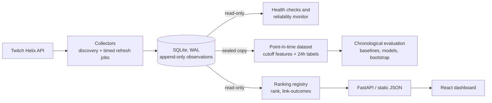

# ViralClip Radar

**Early popularity prediction for Twitch clips, from continuous data collection to a leakage-safe evaluation pipeline, ML model comparison and an interactive dashboard.**


> **Project closed on November 26, 2026.**
>
> The collectors ran 24/7 on a Linux VPS from November 17 to November 26, 2026.
> Before using the data for research I asked Twitch for written permission;
> Twitch declined research use of its data. I stopped collection the same day
> and deleted every collected database, copy, export and log.
>
> **No model results on real data exist or are claimed.** The full pipeline is
> kept as a portfolio project and runs end to end on labeled synthetic data.

## Overview

ViralClip Radar asks one question: **using only what is known in a clip's
first hour, can you tell which Twitch clips will be the most viewed at 24
hours?**

The Twitch API exposes a clip's current view count but keeps no history of
it, so the question cannot be studied from a public dataset. The project
therefore built its dataset prospectively: collectors that discover new clips
and re-measure each one at fixed ages, storing every view count with its real
UTC timestamp. On top of that sits a research pipeline designed so that no
information from after the prediction cutoff can leak into features, splits
or evaluation, plus a ranking registry, an API and a dashboard.

The problem is framed as **ranking**: at a predefined cutoff, rank the clips of
one game category by their expected popularity at 24 hours.

| Setting | Definition |
| --- | --- |
| Prediction cutoffs | 30, 35, 60 and 65 minutes after creation |
| Target | View count at 24 hours of clip age |
| Label window | 86,400–86,700 seconds after creation |
| Categories | Grand Theft Auto V and Grand Theft Auto VI |
| Inputs | Only observations recorded at or before the cutoff |

The question to answer was whether early growth signals and learned models
beat simply ranking clips by their latest observed view count.

## What was built and what was measured

| Implemented and tested (synthetic data, mocked HTTP) | Never measured on real data |
| --- | --- |
| Collector, scheduling, retries, rate-limit handling, storage invariants | Whether any baseline or model ranks real clips better than `latest_views` |
| Point-in-time export, label windows, cohort audit, chronological splits and embargo | Ranking metrics, uncertainty intervals and lift on real cohorts |
| Four baselines, a frozen challenger and a model comparison (ridge, XGBoost, LightGBM, MLP) | Feature importance, calibration and creator holdout on real data |
| Ranking registry, outcome linking, static publishing, FastAPI API and React dashboard | Live rankings of real clips |
| Operational tooling, run in production for ten days | Reboot rehearsal and cold-start recovery |

## System architecture



| Layer | Responsibilities | Technologies |
| --- | --- | --- |
| Data ingestion | Clip discovery, pagination, scheduled refreshes, rate-limit handling | Python, httpx, Twitch Helix API |
| Storage | Persistent jobs, timestamped observations, integrity enforcement | SQLite, WAL, SQL triggers |
| Research | Point-in-time datasets, baseline replay, model comparison | Python, scikit-learn, XGBoost, LightGBM |
| Serving | Prediction registry, outcome linking, ranking export | FastAPI, static JSON |
| Frontend | Interactive ranking dashboard | React, TypeScript, Vite, Tailwind CSS, TanStack Query |
| Infrastructure | Isolated collectors, supervision, health monitoring | Linux, systemd |
| Quality | Unit, integration and browser tests, CI | pytest, Ruff, Vitest, Playwright, GitHub Actions |

### Continuous data ingestion

The collectors discover clips through overlapping UTC minute windows with
pagination, bounded retries and 401/429 handling. Every new clip gets
persistent, idempotent refresh jobs at 10 minutes, 30 minutes, 60 minutes,
6 hours and 24 hours after creation; view counts are refreshed in batches of
up to 100 clip IDs. Each category ran as its own systemd service with its own
service account, SQLite database, single-writer lock and HTTP telemetry log.

At its peak the system tracked hundreds of thousands of clips and recorded
millions of timestamped observations. All of that data has been deleted.

### Storage

SQLite runs in WAL mode with foreign keys, transactions, additive schema
migrations and append-only observations enforced by triggers. Missing,
unavailable and late measurements are stored as such and never as zero views.
Research ran offline on verified online copies, never on the live databases.

### Ranking registry and dashboard

The registry records a ranking at the cutoff before its outcome exists and
links the 24-hour outcome later without changing the prediction, so a
published ranking can be audited honestly. The dashboard reads that registry;
in this repository it runs on a labeled synthetic collector database.

## Modeling and evaluation

### Baselines

| Baseline | Description |
| --- | --- |
| `latest_views` | Latest observed view count available at the cutoff |
| `observed_growth` | Observed increase in views |
| `growth_rate` | Observed rate of view accumulation |
| `age_normalized_views` | View count normalized by observation age |
| Frozen challenger c1 | Staleness-projected view estimate |

### Model comparison

| Model | Role |
| --- | --- |
| Ridge regression | Regularized linear benchmark |
| XGBoost | Gradient-boosted trees |
| LightGBM | Gradient-boosted trees |
| Multilayer perceptron | Small neural network benchmark |

Models are trained on point-in-time features, their predictions are turned
into rankings and compared with the baselines using ranking metrics,
day-level bootstrap intervals and paired differences against `latest_views`.
Tuning uses training and validation days only; the held-out test period is
reserved for one final confirmation under a frozen protocol, and models are
sealed with hashes before the first test day.

### Results

**None on real data.** The pipeline was tested end to end on synthetic data,
which validates the mechanics and says nothing about predictive performance.
The project closed before enough mature, admissible days existed for the
planned chronological splits.

## Leakage prevention and reproducibility

- **Point-in-time features.** Only observations actually recorded by the
  cutoff are eligible. A scheduled 60-minute refresh that arrives late is not
  a 60-minute feature. Historical observations are never reconstructed or
  backdated.
- **Actual age, not target age.** Every job keeps its target age and its real
  measurement time separately.
- **Explicit missingness.** Missing, unavailable, late and immature outcomes
  stay distinct from zero and are excluded from labels rather than imputed.
- **Chronological splits.** Train, validation and test are contiguous UTC
  creation days with boundaries declared before scoring and a 24h + 5 min
  embargo; days with recorded outages are excluded by predefined rules.
- **Coverage is never assumed.** Discovery is popularity-ordered and capped,
  so truncated windows are recorded and cohorts are defined by verifiable
  coverage.
- **Sealed artifacts and frozen protocols.** Exports, manifests and models
  carry SHA-256 hashes and are written to new directories; protocols,
  endpoints and tolerances are versioned and frozen before scoring.
- **Point-in-time text.** Titles and names change after the cutoff, so an
  append-only ledger records them as observed instead of reading the current
  overwritten value.

## Engineering and reliability

- Two isolated collectors on a Linux VPS, supervised by systemd and enabled
  at boot.
- A read-only health command and a five-minute reliability monitor.
- A paired 48-hour production journal check passed with no gap longer than
  six minutes and no unexplained service events.
- Online backup, manifest and isolated-restore tooling, plus Windows Task
  Scheduler supervision for local runs.
- **327 automated Python tests**, 9 Vitest unit tests and 7 Playwright browser
  tests behind one strict offline verifier, run in CI on Windows and Ubuntu:
  pytest, Ruff, Git whitespace, Bash and PowerShell syntax, ESLint,
  TypeScript, Vite build, browser tests and reproducible source packaging
  from Git blobs.

## Project status

| Milestone | Scope | Final status |
| --- | --- | --- |
| M0 | Collector MVP and timestamped observations | Complete |
| M1 | Continuous collection, deployment and reliability | Closed: 48-hour check passed; reboot and cold-start recovery never run |
| M2 | Point-in-time datasets and chronological baselines | Closed: implemented and tested on synthetic data; no real-data scoring |
| M3 | ML training, comparison and validation | Closed: comparison tooling implemented; no real-data training |
| M4 | Prediction serving and dashboard | Complete on synthetic data |

## Quick start

### Requirements

- Python 3.11+ and [uv](https://docs.astral.sh/uv/)
- Node.js (dashboard only)
- Google Chrome (browser tests only)

No Twitch credentials or real data are needed for anything below.

### Verify

```powershell
uv sync --locked
uv run --offline --no-sync python -B scripts/verify_offline.py --strict
```

Each check reports `PASS`, `FAIL`, `SKIP` or `UNKNOWN`. Exit `1` means a failed
check; exit `2` means an unknown result or a skip in strict mode.

### Run the dashboard on synthetic data

```powershell
npm --prefix web ci
npm --prefix web run build
uv run --offline --no-sync viralclip demo
```

Open `http://127.0.0.1:8765`. The demo builds a collector database of clips
labeled `SYNTHETIC / NOT REAL TWITCH DATA` (titled "Clip 1", "Clip 2" and so
on), ranks it through the ranking registry and shows a relative 1–100 score
per clip. It only selects clips: each card links to the clip and to external
video editors, and the site never downloads, uploads or edits video.

### Run the full synthetic pipeline

```powershell
uv run --offline --no-sync viralclip synthetic-dry-run --output data/dry-run
```

This generates a synthetic collector database, then runs the point-in-time
export, the benchmark protocol, a daily replay of the ranking registry and
24-hour outcome linking, and writes `summary.json` to a new Git-ignored
directory. The numbers describe the generator, not Twitch.

### Collector commands

The collector works with your own Twitch application. Review the current
Twitch terms before collecting or using any data.

```powershell
Copy-Item .env.example .env   # set TWITCH_CLIENT_ID and TWITCH_CLIENT_SECRET
uv run viralclip init-db
uv run viralclip collect --game "Grand Theft Auto V" --once
uv run viralclip collect --loop
uv run viralclip health
```

A game name must resolve to an exact Twitch category, otherwise collection
stops; it never substitutes another category. Only one collector may write to
a database at a time (OS file lock). `health` is read-only and needs no
credentials. Other commands: `dataset`, `evaluate`, `rank`, `link-outcomes`,
`shortlist` and `publish` (`--help` on each).

## Repository layout

| Path | Contents |
| --- | --- |
| `src/viralclip/twitch/` | Helix client, OAuth app token, retries, telemetry |
| `src/viralclip/collector/`, `src/viralclip/storage/` | Discovery, refresh jobs, schema, health, backup |
| `src/viralclip/dataset.py`, `evaluation.py`, `challenger.py`, `models.py` | Point-in-time export, benchmark, challenger, model comparison |
| `src/viralclip/predictions.py`, `demo.py`, `publish.py` | Ranking registry, FastAPI demo, static publishing |
| `src/viralclip/synthetic.py` | Labeled synthetic data generator and dry run |
| `web/` | React + TypeScript dashboard |
| `deploy/` | systemd units and environment templates |
| `docs/` | Specification, research contracts and runbooks |

## Documentation

- [Product and engineering specification](docs/PROJECT_SPECIFICATION.md)
- [Point-in-time dataset](docs/POINT_IN_TIME_DATASET.md)
- [Chronological evaluation](docs/CHRONOLOGICAL_EVALUATION.md)
- [Cohort audit](docs/M2_COHORT_AUDIT.md) (Italian)
- [Project manual](docs/PROJECT_MANUAL.md) (Italian)
- [Linux deployment](docs/LINUX_DEPLOYMENT.md) and
  [dual-collector operations](docs/DUAL_COLLECTOR_OPERATIONS.md)
- [Final project status](PROJECT_STATUS.md)

## Limitations

- No model was evaluated on real data, so no predictive claim is made.
- Helix discovery is ordered by views and capped near 1,000 results per query,
  which biases discovery toward popular clips; exhaustive category coverage
  was never certified.
- Ten days of collection would have given only a few mature chronological days
  per split even with permission.

## License

The code is released under the [MIT License](LICENSE). Third-party
dependencies keep their own licenses. No Twitch data, derived datasets or
models are included or retained. The dashboard uses abstract CSS placeholder
artwork and shows no real game footage.
