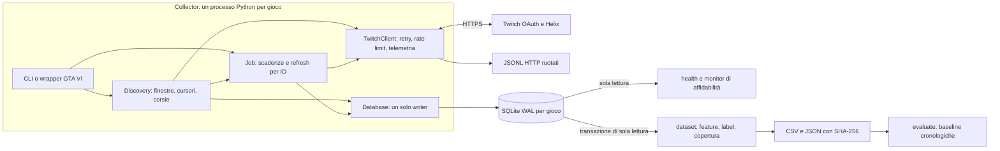
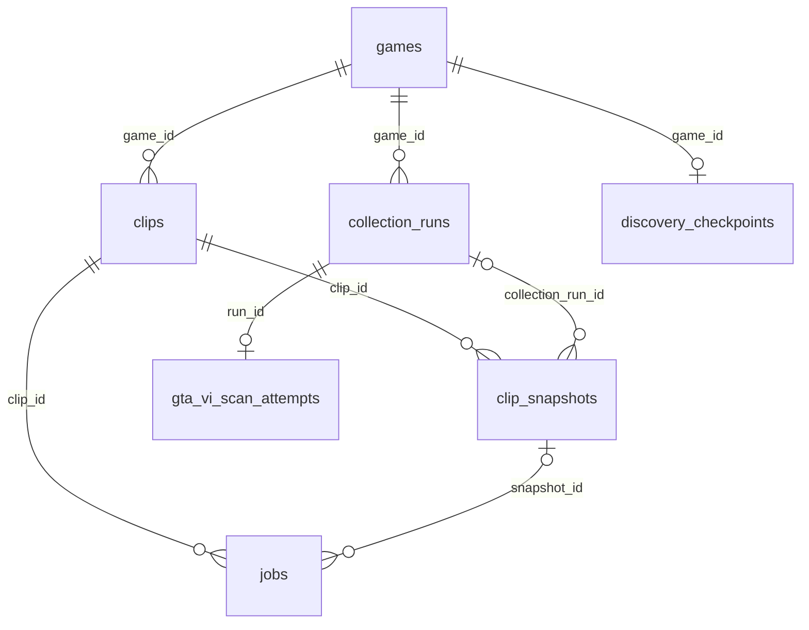

# ViralClip Radar — manuale del progetto

Aggiornato al 24 novembre 2026 sul codice di `main` (`fe53f94`). Questo manuale spiega come funziona il sistema e perché. Non registra lo stato della produzione: per quello vale [PROJECT_STATUS.md](../PROJECT_STATUS.md), e le prove datate sono in [PROJECT_HISTORY.md](PROJECT_HISTORY.md#evidence-log). Quando il codice cambia un contratto descritto qui, aggiorna la sezione corrispondente.

## 1. Scopo

ViralClip Radar vuole indicare quali clip Twitch saranno le più viste a 24 ore usando solo ciò che si sa entro la prima ora. Twitch non conserva lo storico delle visualizzazioni: rileggere oggi una clip restituisce il conteggio di oggi. Il primo prodotto del progetto è quindi una serie di misure raccolte mentre accadono, con l'orario reale di ogni misura. Su questa serie si costruiscono feature, etichette e ranking valutati in ordine cronologico.

Il perimetro M0–M4 è nella [specifica](PROJECT_SPECIFICATION.md). Gli obiettivi successivi per clipper e creator sono nella [visione di lungo termine](LONG_TERM_PRODUCT_VISION.md).

## 2. Architettura

Su Ubuntu ogni gioco ha un collector separato: un processo, un utente di sistema, un database SQLite, un lock e un log HTTP. GTA V usa l'ID categoria `32982`, GTA VI `1867279146`. Gli strumenti di lettura (health, monitor di affidabilità, dataset, audit) aprono il database in sola lettura.

| Modulo | Responsabilità |
| --- | --- |
| [cli.py](../src/viralclip/cli.py) | Comandi `init-db`, `collect`, `status`, `health`, `dataset`, `evaluate`. |
| [twitch/client.py](../src/viralclip/twitch/client.py) | Token d'app, validazione oraria, retry limitati con backoff e jitter, gestione 401/429, telemetria. |
| [collector/service.py](../src/viralclip/collector/service.py) | Discovery per categoria e refresh dei job dovuti a lotti di 100 ID. |
| [storage/database.py](../src/viralclip/storage/database.py) | Schema, migrazioni, lock di processo, scritture transazionali. |
| [storage/discovery.py](../src/viralclip/storage/discovery.py) | Registro delle scansioni GTA VI e frontiere delle corsie. |
| [storage/health.py](../src/viralclip/storage/health.py), [reliability.py](../src/viralclip/reliability.py) | Salute in sola lettura; monitor systemd per i due collector. |
| [dataset.py](../src/viralclip/dataset.py) | Export point-in-time 2a.3. |
| [evaluation.py](../src/viralclip/evaluation.py), [observed_evaluation.py](../src/viralclip/observed_evaluation.py) | Replay cronologico delle baseline. |
| [m2_audit.py](../src/viralclip/m2_audit.py) | Audit delle coorti per giorno UTC e prove di copertura. |
| [operations.py](../src/viralclip/operations.py), [deployment.py](../src/viralclip/deployment.py), [storage/backup.py](../src/viralclip/storage/backup.py) | Backup online, manifest, restore isolato. |
| [gta_vi.py](../src/viralclip/gta_vi.py), [windows_supervision.py](../src/viralclip/windows_supervision.py) | Preflight GTA VI; supervisione con Task Scheduler su Windows. |

## 3. Una clip in un giorno

Una clip nasce alle 14:00 UTC e compare in una risposta di discovery alle 14:05:02. In una sola transazione il collector inserisce la clip con `first_seen_at`, la prima osservazione e cinque job a 10m, 30m, 60m, 6h e 24h dalla creazione Twitch.

- Alle 14:10:03 il job a 10 minuti risulta dovuto. La risposta arriva e viene salvata con età reale 603 s; il job resta collegato a quello snapshot.
- Se la clip fosse stata scoperta alle 14:45, i job a 10m e 30m nascerebbero `missed`. Nessuna misura viene attribuita al passato.
- Se Helix omette la clip in una risposta valida, il job diventa `unavailable`, mai zero visualizzazioni.
- Dopo un riavvio, più job scaduti possono condividere un'unica osservazione reale. Lo snapshot ha target nullo e ogni job conserva il proprio target.
- La misura a 24 ore vale come etichetta solo se cade tra 86.400 e 86.700 secondi di età.

Per la ricerca conta l'orario reale. Una misura a 30m+3s non esiste al cutoff di 30 minuti: entra solo nel dataset a 35 minuti. Allo stesso modo 60m e 65m sono domande diverse.

## 4. Discovery

Helix restituisce le clip di una categoria ordinate per visualizzazioni, non per data, con un massimo pratico di circa 1.000 risultati per ricerca. Nessuna strategia garantisce di vedere tutte le clip: il sistema registra dove la copertura è incompleta.

**GTA V, percorso legacy.** Ogni ciclo interroga gli ultimi 30 minuti, oppure riparte da 5 minuti prima del checkpoint se questo è più indietro, con al massimo 20 pagine. Una finestra vicina a 900 righe o a 10 pagine viene divisa a metà. Il checkpoint avanza solo se tutte le sotto-finestre sono complete; altrimenti il run resta `partial`.

**GTA VI, corsie strutturali.** Il tempo è diviso in intervalli di 10 minuti allineati in UTC. Ogni ciclo esegue:

| Corsia | Intervallo | Pagine |
| --- | --- | --- |
| `recent` | intervallo corrente | 10 |
| `recent` (sovrapposizione) | intervallo precedente | 7 più pagine extra fino a `VIRALCLIP_GTA_VI_OVERLAP_PAGES` (8 in produzione), entro 15 s e solo con token e budget già disponibili |
| `history` | dalla frontiera storica in avanti | 3 |
| `retry` | un intervallo storico incompleto più vecchio di 30 minuti, quando la storia è in pari | 3 |

Ogni scansione registra un esito in `gta_vi_scan_attempts`: `cursor_exhausted`, `known_incomplete` (il cursore è finito ma mancano ID già noti), `page_limit`, `budget`, `pagination_anomaly` o `error`. Il contesto delle scelte è in [GTA_VI_PILOT.md](GTA_VI_PILOT.md) e [GTA_VI_DISCOVERY_REPLAY.md](GTA_VI_DISCOVERY_REPLAY.md).

Tra una pagina e l'altra il collector esegue prima i job dovuti: le misure programmate hanno priorità sulla discovery.

## 5. Dati

Invarianti garantite dal codice:

- `clip_snapshots` è append-only: due trigger bloccano update e delete. La chiave `(clip_id, observed_at, source)` evita doppioni dello stesso evento.
- `first_seen_at` non viene mai sovrascritto; `last_seen_at` sì.
- I job sono unici per clip e target, hanno al massimo tre tentativi e un nuovo tentativo dopo 30 secondi.
- Stati dei job: `pending`, `running`, `completed`, `missed`, `failed`, `unavailable`.
- Lo schema versionato è alla v2. La tabella `gta_vi_scan_attempts` viene creata al bisogno dal collector GTA VI e non cambia la versione, così gli strumenti che richiedono la v2 restano compatibili.
- WAL, chiavi esterne e un lock di sistema operativo impediscono due collector sullo stesso database. `status` apre il writer e può migrare; per ispezionare si usano `health` o `mode=ro`.

## 6. Pipeline di ricerca

**Export 2a.3** (`viralclip dataset`). Seleziona le clip per gioco e intervallo di creazione UTC, congela un watermark e produce per ogni clip quattro candidati (30, 35, 60, 65 minuti) e un esito a 24 ore. Le feature usano solo osservazioni con `observed_at` ≤ cutoff:

| Feature | Significato |
| --- | --- |
| `first_views`, `latest_views` e i loro `log1p` | Prima e ultima vista disponibili al cutoff. |
| `first_/latest_observation_age_seconds` | Età reale di quelle misure. |
| `discovery_delay_seconds`, `staleness_seconds` | Ritardo della scoperta; distanza tra ultima misura e cutoff. |
| `observation_count`, `observed_view_growth`, `growth_views_per_minute` | Numero di misure e crescita fra la prima e l'ultima. |

Stati delle feature: `eligible`, `late_discovery`, `missing_observations`, `cutoff_immature`. Stati dell'esito: `valid`, `immature`, `missing`, `unavailable`, `outside_window`, `invalid_link`. I file hanno hash SHA-256 nel manifest e i broadcaster compaiono solo come pseudonimi di audit. Dettagli in [POINT_IN_TIME_DATASET.md](POINT_IN_TIME_DATASET.md).

**Baseline.** Quattro regole senza parametri: `latest_views`, `observed_growth`, `growth_rate` (crescita per minuto reale) e `age_normalized_views`. Il pool è un gioco in un giorno UTC. Sono rilevanti le clip nel primo 10% per visualizzazioni a 24 ore, pareggi inclusi. Esempio con dieci clip `100,100,65,50,40,30,20,10,2,1` e un metodo che restituisce `100,65,50`: Precision@3 = 1/3, Recall@3 = 1/2, NDCG@3 ≈ 0,959.

**Split ed embargo.** Gli split di addestramento, validazione e test seguono la data di creazione e i confini cadono a mezzanotte UTC. Un'etichetta conta in uno split solo se l'intera finestra 24h+5m è trascorsa prima dell'inizio dello split successivo. Servono almeno 2 giorni utilizzabili per split, e i confini vanno dichiarati prima di leggere le metriche. Altrimenti il report dice `INSUFFICIENT DATA` o `SPLIT BOUNDARIES REQUIRED` e non mostra punteggi.

**Due coorti di valutazione.**

| Coorte | Quali clip | Quando un giorno è utilizzabile |
| --- | --- | --- |
| `primary` (politica `legacy-search-day-v2`) | Clip con etichetta valida, uguali ai quattro cutoff. | Giorno maturo, senza interruzioni dichiarate, 86.400 s coperti da run legacy completi e verificati, nessun problema irrisolto, almeno 10 clip con esiti diversi. I run del registro strutturale non contano come copertura legacy, quindi oggi nessun giorno GTA VI può essere ammesso. |
| `observed-at-cutoff` (solo GTA VI, export 2a.3) | Clip già scoperte al cutoff. Le classifiche vengono congelate in `recommendations.csv` prima di leggere gli esiti. | Giorno UTC coperto e maturo, senza interruzioni e fuori dall'embargo. Obiettivo sperimentale: 7, 3 e 7 giorni e almeno 500 etichette di test, K=10, cutoff principale a 60 minuti. |

La seconda coorte misura il caso d'uso del ranking dal vivo, che ordina solo ciò che il radar ha già visto. La prima serve a sostenere conclusioni sull'intera popolazione Twitch. Regole complete in [CHRONOLOGICAL_EVALUATION.md](CHRONOLOGICAL_EVALUATION.md) e [M2_COHORT_AUDIT.md](M2_COHORT_AUDIT.md).

## 7. Contratto del ranking dal vivo

È la priorità di prodotto n. 1 e non è ancora implementata. Ciò che esiste e ciò che manca:

| Passaggio | Stato |
| --- | --- |
| Discovery e osservazioni reali | Implementato. La copertura assoluta resta sconosciuta. |
| Feature al cutoff | Implementate nel builder offline e riutilizzabili. Il calcolo per singola clip all'istante del cutoff è da progettare. |
| Score immutabile | Da progettare: modello o regola di fallback, versione dello score, istante della previsione, cutoff, provenienza delle feature. La specifica prevede uno stato `not_trained_yet` quando manca un modello. |
| Classifica di un pool comparabile | Esiste come replay privato; come classifica per utenti e demo è prevista in M4. |
| Verifica a 24 ore | La raccolta dell'esito esiste. Il collegamento con la previsione registrata va aggiunto senza mai modificare la previsione. |

Il prossimo passo dichiarato è definire questo record e provarlo offline con una baseline e dati sintetici.

## 8. Decisioni aperte

| Decisione | Opzioni e informazioni mancanti |
| --- | --- |
| Benchmark principale | `primary` richiede una prova di copertura che per GTA VI oggi non esiste; `observed-at-cutoff` corrisponde al prodotto ma non sostiene conclusioni sull'intera popolazione. |
| Endpoint e cutoff principali | Conteggio a 24 ore o primo decile; 30m/60m decidono prima, 35m/65m vedono più dati. Va dichiarato prima della valutazione definitiva. |
| Sufficienza statistica | Due giorni per split sono un minimo tecnico. Servono stima dell'incertezza, stabilità fra giorni e confronto con una scelta casuale. |
| Modello, metrica e calibrazione (M3) | Regressione logistica o boosting, NDCG o precision. Uno score diventa probabilità solo dopo una calibrazione verificata. |
| Pubblicazione | Demo con dati sintetici. Dati, derivati e pesi reali restano privati finché non sono stati verificati i termini d'uso. |
| Operazioni M1 | Prova di riavvio (finestra candidata: 27 novembre, 09:00 UTC) e chiusura del gate di 48 ore. Il backup fuori VPS è stato escluso con una rinuncia esplicita. |

## 9. Glossario essenziale

| Termine | Significato nel progetto |
| --- | --- |
| Cutoff | Istante massimo ammesso per le feature, contato dalla creazione della clip. |
| Watermark | Limite temporale dei dati considerati: nel dataset esclude misure e maturità successive; in discovery è il punto fino a cui la copertura è gestita. |
| Snapshot | Una misura di visualizzazioni con il suo orario reale. Non va confuso con lo snapshot di lettura di SQLite. |
| Target age ed età reale | Età prevista per il job (es. 600 s) ed età effettiva della misura (es. 603 s). |
| Maturità | Un esito è maturo quando la sua finestra 24h–24h05 è interamente trascorsa al watermark. |
| Embargo | Esclusione delle etichette non mature prima dell'inizio dello split successivo. |
| Leakage | Uso, diretto o indiretto, di informazione futura. |
| Pool matched | Clip con feature ed esito validi a tutti e quattro i cutoff. |
| Censura | Esito non ancora osservabile o non osservato; resta esplicito, non diventa zero. |
| Precision, Recall, NDCG | Quota di suggerimenti rilevanti; quota di rilevanti trovati; premio per esiti alti nelle prime posizioni. |
| Saturazione | Una finestra di ricerca vicina al limite di risultati, quindi forse incompleta. |
| WAL | Il log di SQLite che permette ai lettori di vedere i commit mentre il writer lavora. Una copia del solo file principale può perdere dati: si usa il backup online. |
| GO, NO-GO, PARTIAL, UNKNOWN | Accettato; respinto; in parte provato; prova assente. |

## 10. Dove trovare cosa

| Argomento | Documento |
| --- | --- |
| Stato, priorità e prossimi passi | [PROJECT_STATUS.md](../PROJECT_STATUS.md) |
| Prove datate e decisioni passate | [PROJECT_HISTORY.md](PROJECT_HISTORY.md#evidence-log) |
| Requisiti e criteri di accettazione | [PROJECT_SPECIFICATION.md](PROJECT_SPECIFICATION.md) |
| Avvio rapido, health, telemetria | [README.md](../README.md) |
| Deploy Linux e due collector | [LINUX_DEPLOYMENT.md](LINUX_DEPLOYMENT.md), [DUAL_COLLECTOR_OPERATIONS.md](DUAL_COLLECTOR_OPERATIONS.md) |
| Rollout e gate M1 | [MILESTONE_1_ROLLOUT.md](MILESTONE_1_ROLLOUT.md), [M1_RELIABILITY_HARDENING.md](M1_RELIABILITY_HARDENING.md) |
| Backup e monitor | [BACKUP_AND_MONITORING.md](BACKUP_AND_MONITORING.md) |
| Supervisione, backup e controlli su Windows | [WINDOWS_SUPERVISION.md](WINDOWS_SUPERVISION.md) |
| Dataset, valutazione e audit M2 | [POINT_IN_TIME_DATASET.md](POINT_IN_TIME_DATASET.md), [CHRONOLOGICAL_EVALUATION.md](CHRONOLOGICAL_EVALUATION.md), [M2_COHORT_AUDIT.md](M2_COHORT_AUDIT.md) |
| Visione dopo M4 e fasi M5–M11 | [LONG_TERM_PRODUCT_VISION.md](LONG_TERM_PRODUCT_VISION.md) |
