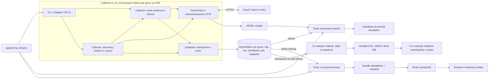
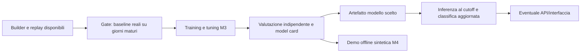
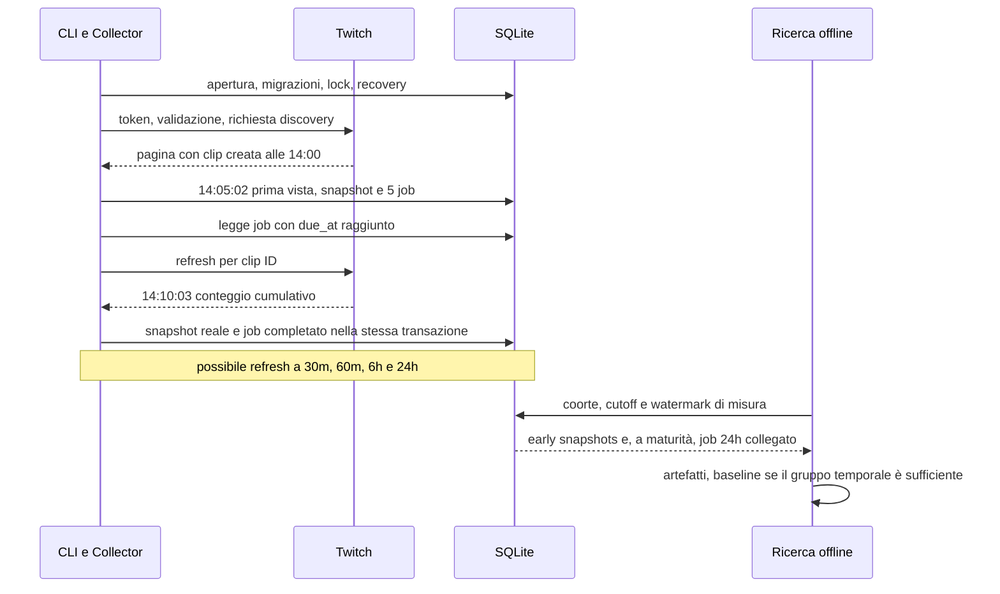
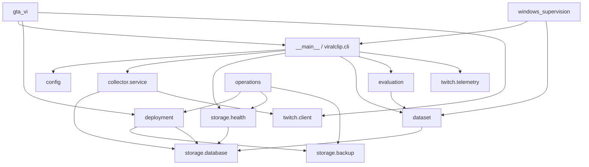

# 3–4 e 7. Architettura, ciclo di vita e chiamate

[Indice](00-INDEX.md) · [Twitch e scheduler](05-TWITCH-AND-COLLECTION.md) · [Schema](06-DATABASE.md) · [Infrastruttura](07-INFRASTRUCTURE.md) · [Schede](04-CODE-WALKTHROUGH/00-GUIDE.md)

## Componenti effettivi

Un **processo** ha memoria e ciclo di vita propri. Discovery, gestione dei job e client HTTP sono oggetti o funzioni nello stesso interprete, chiamati in sequenza. Il termine **scheduler** in raccolta indica selezione periodica dei job SQLite. Il timer di **systemd** invece avvia programmi separati in orari di calendario.

Il diagramma rappresenta codice e configurazioni disponibili. Su Windows una CLI manuale ha lo stesso nucleo. È disponibile anche il wrapper Task Scheduler, con watcher della pausa nello stesso processo. Su Ubuntu GTA V e GTA VI hanno processi, directory e DB distinti. L'installazione attuale dei processi ausiliari resta **UNKNOWN**. [Service e timer](../../deploy) · [Evidenza datata](11-CURRENT-STATUS.md)

| Componente | Ingresso → uscita e responsabilità | Fallimento ed effetto |
| --- | --- | --- |
| CLI e configurazione | Argomenti, ambiente e default → comando, DB e categorie selezionati. | Intervalli invalidi o credenziali assenti impediscono la raccolta. Il ramo writer può avere aperto il DB prima del controllo. |
| Autenticazione | ID e secret → app token in memoria, validazione client e rinnovo. | Rifiuto o rete dopo retry → `TwitchAPIError`. La query attuale non produce misure. |
| Discovery | Categoria, checkpoint, orologio → run, clip, snapshot e watermark. | Cursor o payload invalido può lasciare righe già confermate e checkpoint conservato. Saturazione segnala incompletezza. |
| Job e snapshot | Target derivati dalla creazione → pending SQLite → query per ID → snapshot e job. | Omissione valida, errore o riavvio causano stati distinti. L'append avviene con tempo osservato reale. |
| Persistenza | Transazioni e SQL parametrizzato → file SQLite, WAL, lock. | Il rollback rende atomiche le operazioni locali. Errori DB non sono necessariamente recuperati dal loop di applicazione. |
| Logging | Eventi di tentativo, ritardo, retry e OAuth → JSONL locale, stdout/stderr in journal sotto systemd. | La telemetria best effort può sparire senza fermare richieste. |
| Monitor | Snapshot SQL read-only, journal/JSONL dove applicabile, stati systemd, spazio, marker → severità o aggregati. | Errori di lettura/metriche possono risultare critici o UNKNOWN secondo lo strumento. Un heartbeat può fallire indipendentemente dal collector. |
| Backup/restore | Copia SQLite, manifest, Restic e profilo → bundle verificato e prova di ripristino isolata. | Spazio, quote, credenziali, integrità, identità o hash possono bloccare una fase. Un fallimento remoto conserva la copia locale verificata. |
| Builder | Coorte UTC e watermark → righe per cutoff e outcome separato. | Schema incompatibile, watermark non disponibile o percorso non ammesso fermano l'export. Feature o label mancanti restano esplicite. |
| Ranking | Artefatti con hash, confini temporali, K → report di copertura o metriche dei metodi semplici. | Artefatto incoerente → errore. Dati insufficienti → report senza metriche. |

Riferimenti diretti per riga nel [catalogo del codice](04-CODE-WALKTHROUGH/00-GUIDE.md). Contratti di [salute e operazioni](07-INFRASTRUCTURE.md), [estrazione](08-DATA-PIPELINE.md) e [valutazione](09-MACHINE-LEARNING.md).

## Componenti progettati e integrazioni ancora aperte

La specifica prevede il confronto di un modello semplice e uno ad alberi e una demo offline. Un servizio di inferenza con API/UI è una possibile architettura di prodotto. Le interfacce, l'aggiornamento di una classifica online e il monitor prestazioni non hanno un'implementazione o un contratto approvato in questi file. [Specifiche M3 e M4](../PROJECT_SPECIFICATION.md#6-milestone-3--machine-learning) · [Decisioni aperte](15-DECISION-REGISTER.md)

## Esempio guida. Clip creata alle 14:00 UTC

1. L'operatore avvia il comando o lo avvia il supervisore. `cli.main` prima interpreta gli argomenti, carica `Settings`, poi per la raccolta inizializza `Database` e controlla la presenza di campi credenziali e categorie. `Collector.__init__` prende il lock e recupera i job in esecuzione. Il client ottiene e valida il token alla prima chiamata Helix, anche se l'avvio statico era già passato.
2. Supponiamo che una pagina del ciclo successivo sia osservata alle 14:05:02. La stessa transazione registra clip, prima misura e cinque scadenze, alle 14:10, 14:30, 15:00, 20:00 e alle 14:00 del giorno seguente. Solo le scadenze future alla scoperta diventano pending.
3. Quando la scadenza è raggiunta, il loop interroga la coda e il refresh riceve un conteggio. Se arriva alle 14:10:03, salva età effettiva 603 e ritardo 3, pur legandolo al target 600. La query degli ID è ordinata per job dovuti e il risultato è associato tramite ID. Analogamente, un refresh alle 14:30:03 manca il cutoff delle 14:30:00 e può essere usato a 35 minuti. Una misura reale alle 15:00:04 resta fuori da 60 e può entrare a 65.
4. Per assegnare una label servono un refresh 24h in finestra, il collegamento valido e un watermark almeno alle 14:05 del giorno seguente. Se la misura è alle 14:02 e il watermark è ancora alle 14:03, l'outcome è immature. Alle 14:05 la stessa misura può diventare `valid`. Il builder può comunque esportare righe audit senza label. La clip entra in `dataset.csv` con una riga per ogni cutoff con feature disponibili e label valida.
5. Un replay può confrontare gli score solo quando dispone dei pool maturi e degli split previsti. L'esempio di una clip dimostra il flusso delle righe. Un futuro modello, una volta addestrato e accettato, potrebbe assegnare uno score già al cutoff usando le misure fino a quel momento, senza aspettare la label di quella clip.

Le ore di risposta qui sono illustrative. L'API può omettere la clip, la finestra può essere parziale, il collector può essere spento, una richiesta può ritardare il loop e un job può essere eseguito dopo un cutoff. [Casi A–F](13-END-TO-END-EXAMPLES.md) · [Selezione esatta](08-DATA-PIPELINE.md)

## Entry point e mappa delle chiamate

| Entrata | Funzione → chiamanti e risorse del percorso |
| --- | --- |
| `viralclip` / `python -m viralclip` | `cli.main → load_settings`. `init-db/status → Database.__init__ → migrate`. `health → read_health → SQLite RO`. |
| `collect --once/--loop` | `cli.main → Collector.__init__ → acquire_collector_lock/recover_running_jobs → collect_cycle → collect_due_snapshots/discover → TwitchClient → SQLite`. Nei tick intermedi la CLI chiama direttamente `collect_due_snapshots`. |
| `discover` | `collect_cycle → resolve_game` per i nomi o `upsert_game` per ID nuovi. `discover → _whole_minute_window → _discover_window → get_clips/record_clip/finish_run`, poi `update_watermark` se completo. |
| `refresh` | `collect_cycle`, `_discover_window` e loop intermedio → `collect_due_snapshots → due_jobs/start_jobs → get_clips → finish_jobs/add_scheduled_snapshot`. |
| `dataset` | `cli.main → extract → ignored_output/read_source → candidate e outcome → filesystem CSV/JSON`. |
| `evaluate` | `cli.main → run_evaluation → read_inputs → evaluate → _period/_scores → ranking_metrics`. Input e output su filesystem, stato scritto nel report. |
| `python -m viralclip.storage.backup` | `main → backup_and_verify → online_copy/validate`. Usato anche da operations e restore. |
| `python -m viralclip.deployment` | `main → preflight / snapshot_manifest / verify_snapshot → SQLite RO + hash`. Usato anche dalle unità e dai runbook. |
| `python -m viralclip.operations` | `main → probe, run_backup, monitor, restore_latest, init/check Restic`. Le unità oneshot invocano i rami pertinenti. |
| `python -m viralclip.gta_vi` | `resolve → Get Games`. `run → _preflight → cli.main` nello stesso processo. |
| `python -m viralclip.windows_supervision` | `prepare → task_xml`. `run → _run → supervise → preflight/cli.main`. `pause/resume/state` interagiscono con un file locale. |
| `scripts/package_release.py` e `scripts/verify_offline.py` | Tool invocati localmente e da CI. Git, filesystem temporaneo, pytest, Ruff e parser delle shell. |

[Entry point installato](../../pyproject.toml) · [Schede con firme e chiamanti](04-CODE-WALKTHROUGH/00-GUIDE.md)
