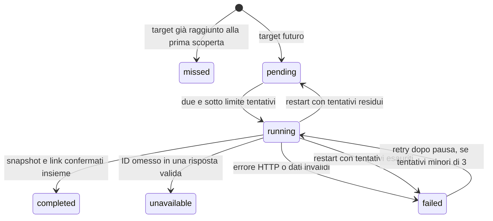

# 8–11. Twitch, discovery, snapshot e due collector

[Indice](00-INDEX.md) · [Schede di raccolta](04-CODE-WALKTHROUGH/01-COLLECTION.md) · [Database](06-DATABASE.md) · [Esempi](13-END-TO-END-EXAMPLES.md)

## 8. Da una richiesta HTTP a un conteggio

Un endpoint è un percorso HTTP che implementa un'operazione. La richiesta è un messaggio con metodo, parametri e intestazioni. `httpx.Client` riutilizza le connessioni e consegna uno status, header e corpo JSON. Un token **app** identifica l'applicazione. Il client conserva il secret per ottenere il token, poi manda il token e il Client ID a Helix. La raccolta di metadati pubblici praticata qui usa il grant client credentials, senza richiedere il consenso o scope di modifica del singolo broadcaster. La lettura delle specifiche pubbliche del 20 novembre è distinta da una chiamata autenticata. [OAuth Twitch](https://dev.twitch.tv/docs/authentication/getting-tokens-oauth/#client-credentials-grant-flow) · [Referenza Helix](https://dev.twitch.tv/docs/api/reference/)

| Chiamata | Parametri inviati e risposta consumata | Uso nel progetto |
| --- | --- | --- |
| `POST id.twitch.tv/oauth2/token` | Corpo form `client_id`, `client_secret`, `grant_type=client_credentials`. Legge `access_token` non vuoto e `expires_in` intero positivo. | Iniziale, prima della scadenza prevista oppure dopo un 401 Helix. Token mantenuto in RAM. |
| `GET id.twitch.tv/oauth2/validate` | Header `Authorization: OAuth …`. Richiede HTTP 200 e `client_id` esattamente uguale. | Alla prima richiesta con un nuovo token e quando è trascorsa almeno un'ora dalla validazione. Controllo opportunistico alla richiesta, senza timer proprio in idle. |
| `GET /helix/search/categories` | `query`, `first=100`, `after` eventuale. Legge `data` e cursore, richiede `id` e `name` stringhe. | Nome configurato, entro 10 pagine, termina appena una pagina contiene match esatto case-insensitive. |
| `GET /helix/games` | Esattamente uno di `name` o `id`. Legge lista `data`. | Verifica esplicita GTA VI in due direzioni, nome → ID → stesso nome e ID. Passare un ID al collector generico salta questa richiesta. |
| `GET /helix/clips` per categoria | `game_id`, `first=100`, estremi UTC `started_at` e `ended_at` nel flusso reale, più `after` eventuale. | Discovery. Usa `id`, `created_at` e conteggio obbligatori più metadati facoltativi. Il client processa le risposte nell'ordine di arrivo. |
| `GET /helix/clips` per ID | Chiave `id` ripetuta fino a 100 valori. | Refresh puntuale. Indicizza il payload per ID, associa anche risposte in ordine diverso. |

[Client Twitch](../../src/viralclip/twitch/client.py) · [Validate tokens](https://dev.twitch.tv/docs/authentication/validate-tokens/) · [Get Clips](https://dev.twitch.tv/docs/api/reference/clips#get-clips) · [Search Categories](https://dev.twitch.tv/docs/api/reference/search#search-categories) · [Get Games](https://dev.twitch.tv/docs/api/reference/games#get-games)

### Retry, rate limit e scarto dei dati

Il client gestisce separatamente acquisizione del token, validazione e GET Helix. Ognuno ammette per default tre retry transitori oltre al tentativo iniziale. Un errore di rete o timeout, un 429 o uno status almeno 500 può attivare la ripetizione. Un 401 su Helix forza una sola nuova acquisizione con nuova validazione e un ulteriore tentativo Helix. Un altro 401 esce in errore. La configurazione predefinita usa 5 secondi come timeout di connessione e 15 per gli altri timeout HTTP. Ogni tentativo Helix può essere preceduto da una pausa fino al reset noto se l'ultimo header `Ratelimit-Remaining` segnava zero. [Costruttore e retry](../../src/viralclip/twitch/client.py#L22) · [Regole ufficiali](https://dev.twitch.tv/docs/api/guide/#twitch-rate-limits)

Per tentativo transitorio con indice zero-based `i`, l'attesa base è `min(30, 2**i) + uniform(0, 0.25)` secondi. Su 429 il client sceglie il massimo fra base, `Retry-After` in secondi o data HTTP meno ora, e `Ratelimit-Reset` meno ora. Con ora epoch 1000, reset a 1012 e retry-after 8 si attende 12 secondi, date valide. Il limite di 30 riguarda l'esponenziale. Valori header enormi o non finiti accettati da `float` rappresentano un limite della durata reale del loop. Le richieste e le attese sono sincrone e la priorità refresh non interrompe un GET o uno sleep già in corso. [Calcolo](../../src/viralclip/twitch/client.py#L231) · [Test audit](../../tests/test_audit.py) · [Test collector](../../tests/test_collector.py)

La forma di `data` deve essere lista di oggetti, `pagination` oggetto e `cursor` stringa se presente. Ogni clip richiede ID non vuoto, conteggio intero non booleano ≥0 e timestamp con offset. `created_at` viene convertito in UTC. Un dato richiesto malformato interrompe il ramo che lo processa. Un payload refresh valido privo di un ID richiesto rende i job corrispondenti `unavailable`. Uno status HTTP fallito o una lista malformata rende i job `failed`. Zero visualizzazioni è una misura concreta. Una clip che manca dalla ricerca della categoria resta semplicemente non osservata, con cause indeterminate. I messaggi client creati per gli errori evitano di includere corpo, secret o token. [Parser e refresh](../../src/viralclip/collector/service.py) · [Test malformazione e omissione](../../tests/test_audit.py)

## 9. Come viene scoperta una clip

Il loop misura la cadenza con `time.monotonic`, un contatore che avanza col trascorrere del tempo. Il primo ciclo parte subito. La cadenza configurata è di 300 secondi per default. Tra i cicli esegue solo snapshot e poi dorme `min(5, intervallo)` secondi. La scadenza è programmata all'inizio del ciclo. Un ciclo lungo può quindi far cominciare il successivo più tardi del previsto. [Loop CLI](../../src/viralclip/cli.py#L176)

1. Per un nome, `resolve_game` cerca un record con nome equivalente in SQLite, valido fino a 30 giorni. Un miss invoca la ricerca esatta. Un ID esplicito viene registrato come nome provvisorio se è nuovo, senza ricerca. Ogni errore Twitch di categoria viene registrato e il ciclo cerca anche le altre categorie. A fine ciclo l'errore può essere ripropagato.
2. `_whole_minute_window` produce `end` troncando l'ora UTC al minuto e `start = min(end - lookback, checkpoint - 5m)` se esiste il checkpoint. Esempio: ore 14:39:24, lookback 30, checkpoint 13:59 → end 14:39, start 13:54. Senza checkpoint usa 14:09. Prima del primo run salva un valore bootstrap `start+5m` affinché un errore iniziale conservi lo stesso margine al tentativo seguente.
3. `_discover_window` apre un run persistente in stato `running` e processa i job dovuti prima di ogni pagina. Richiede fino a 100 clip chiedendo la pagina successiva col cursore. Per ogni pagina preleva un orario reale dopo il parsing del contenitore, comune alle clip della pagina. Per ogni clip valida, `record_clip` conferma una transazione di upsert, append e primi job. Se una riga successiva è malformata, le transazioni precedenti restano.
4. Il DB deduplica le identità e conserva `first_seen_at`. Due discovery sovrapposte a orari diversi producono osservazioni diverse. Il set ID nel run conta il numero di ID diversi, ma il ciclo continua a leggere e misurare i duplicati di pagina. `clips_seen` conta le righe, `unique_clips` gli ID distinti per run, `new_clips` i primi inserimenti. `request_count` riguarda chiamate logiche del run e `pages_seen` le risposte ottenute, non tutti i retry HTTP. Per questi ultimi serve la telemetria.
5. Il collector marca troncamento a 900 risultati anche se non c'è cursore. Con meno di 900 marca troncamento a dieci pagine se rimane cursore, o all'esaurimento del budget mentre servivano pagine. Parte con un budget condiviso di 20 richieste logiche per discovery, inclusa la finestra madre. Se il run è troncato, ha ancora budget e dura almeno due minuti, prova due metà con midpoint troncato al minuto, prima a sinistra. La copertura torna completa solo se entrambe le metà riescono. Il parent resta registrato parziale. Una metà può consumare il budget prima dell'altra.
6. Se l'albero è completo, il checkpoint avanza a `end`. Su incompleto o errore conserva il checkpoint precedente o il valore bootstrap. Un gap da downtime allarga la finestra alla ripresa. In assenza di dati nel corso del gap il collector può scoprire in ritardo e registrare il conteggio attuale. Nessun codice ricostruisce le osservazioni che sarebbero avvenute nel gap.

```text
budget condiviso = 20
scansiona [inizio, fine]   (prima refresh, poi discovery per ogni pagina)
  conferma le clip valide appena osservate
  se troncata e divisibile con budget residuo:
     esito_sinistra = scansiona(sinistra)
   esito_destra = scansiona(destra) con il budget rimanente
   risultato = esito_sinistra AND esito_destra
  altrimenti: risultato = cursor concluso e soglie rispettate
avanza al nuovo fine soltanto se risultato
```

Helix documenta estremi RFC3339 troncati al minuto, esattamente un selettore tra game, broadcaster e ID, e circa 1.000 risultati attraverso la paginazione. Il collector usa solo game oppure ID. Con l'ordine per view count documentato di Helix, le clip più popolari tendono ad apparire prima nella ricerca per categoria. In una finestra con alta densità, una prima pagina da 100 costa poco ma può nascondere la coda. Più pagine, finestre minori e overlap aumentano possibilità di scoperta e consumo. Anche un run vuoto può essere completo dal punto di vista dei cursori. Nessun run dimostra copertura assoluta di Twitch. Il codice non effettua un filtro temporale locale rigido sulle risposte discovery o un confronto del `game_id` del payload. Si appoggia al selettore Helix e attribuisce la categoria richiesta. [Algoritmo](../../src/viralclip/collector/service.py#L42) · [Get Clips](https://dev.twitch.tv/docs/api/reference/clips#get-clips) · [Regressioni](../../tests/test_audit.py)

## 10. Scheduler durevole

Il job rappresenta una richiesta futura di osservazione. La sua identità è `(clip_id, view_snapshot, target_age_seconds)`. La data dovuta è creazione + target. Se è uguale o precedente alla prima scoperta è già `missed`, con completamento registrato al tempo della scoperta per l'audit dello stato. I job pendenti non usano una scadenza massima generale. Un job conosciuto prima del blackout, anche passato da ore, può essere ripreso con età effettiva. [Creazione e query](../../src/viralclip/storage/database.py) · [Test ritardo](../../tests/test_collector.py)



- **Selezione.** `due_jobs` prende fino a 1.000 job con `due_at ≤ ora`, stato pending o failed, meno di tre tentativi e `retry_at` nullo o già trascorso, in ordine di scadenza.
- **Raggruppamento.** `collect_due_snapshots` raggruppa per clip ID, suddivide in gruppi da massimo 100 ID, segna tutti i job del batch running e incrementa i tentativi prima del GET.
- **Successo.** Una risposta per la stessa clip completa uno o più job selezionati con una sola misura. Se il gruppo ha un job, il target è riportato anche nello snapshot. Se ha più job, il target dello snapshot è nullo perché il link esplicito in ogni job porta l'informazione. L'età è `observed_at − created_at`. Il ritardo per target è `observed_at − due_at`.
- **Omissione o errore.** Un ID omesso determina unavailable definitivo per i job tentati, senza uno snapshot sintetico. Per un failed l'attesa persistita è 30 secondi, con massimo tre tentativi totali del job. I retry di HTTP interni sono un altro contatore. I job futuri della stessa clip rimangono indipendenti.
- **Riavvio.** Il lock viene rilasciato dal kernel alla morte del processo. Il nuovo proprietario marca i run running come error interrotti e rimette in pending i job running con tentativi residui. Il client, i cursori in memoria e la cadenza monotona vengono ricreati. Il checkpoint e le osservazioni confermate restano.
- **Qualità.** Il conteggio può essere valido come misura e tardivo per una specifica feature o label. Il builder può accettare un discovery misurato prima del cutoff anche se il job si è perso. A 24h la regola è più stretta e richiede il legame con il target, oltre alla finestra di cinque minuti.

```text
t0 14:00 → found 14:45 → 10m missed, 30m missed
                         60m pending → 15:00:04 => age 3604, ritardo 4s
                         6h pending → 20:00 se disponibile
                         24h pending → domani 14:00 se disponibile
scenario blackout: found 14:05 → down 14:09 → up 14:36
                   10m e 30m erano pending → una misura verso 14:36 può legare entrambi
```

[Transazioni e chiavi](06-DATABASE.md) · [Casi A–F](13-END-TO-END-EXAMPLES.md)

## 11. GTA V, GTA VI e crescita a più giochi

GTA V corrisponde a `32982` e GTA VI a `1867279146`. Il run GTA VI esige esattamente l'ID approvato, categorie generiche vuote, intervallo 300 s, lookback 10 min, path/HTTP log allineati e file writable non aliasati. L'ID GTA V è verificato nei backup e nell'audit di categoria. Il servizio collector GTA V usa invece il nome alla CLI e proibisce gli ID extra nel proprio preflight. La configurazione pilot prescrive ID e credenziali Twitch separati operativamente. Due app sono utili anche perché i budget Twitch sono per client/app. Entrambi riusano il codice, le tabelle, i target e il protocollo Helix. [Wrapper GTA VI](../../src/viralclip/gta_vi.py) · [Preflight GTA V](../../src/viralclip/deployment.py) · [Unità e percorsi](07-INFRASTRUCTURE.md)

Un path incrociato può mescolare le misure se il collector generico opera su un DB eterogeneo. Il lock limita i writer concorrenti sulla stessa identità di path, mentre i preflight di categoria e i controlli su device/inode, handle del PID, righe per categoria e backup forniscono prove a livelli diversi. I campioni operatori del 19 novembre indicavano progressione e categorie coerenti su entrambi. La topologia effettiva odierna resta **UNKNOWN**. [Campioni precedenti](../PROJECT_HISTORY.md#2026-11-19-operator-production-evidence-and-milestone-1-release-review)

Per osservare un terzo gioco a livello di prototipo, la CLI generica accetta già liste di nomi e ID e lo schema collega categorie, clip e run. Per replicare l'isolamento dual-collector a tre, quattro o dieci giochi occorrono per profilo unità, assembly dei percorsi, account, ID, app/budget, verifica startup, retention, backup e monitor. Le guardie GTA V/GTA VI, i due script di health e i runbook sono specifici. A dieci giochi l'accumulo di DB, scritture, rapporti e query API può rendere conveniente una configurazione dichiarativa comune, se si decide di generalizzare. Il risultato dipenderebbe da densità, capacità e quote, da misurare per gioco. [Decisioni](15-DECISION-REGISTER.md) · [Limiti](10-TESTING-AND-RELIABILITY.md)
