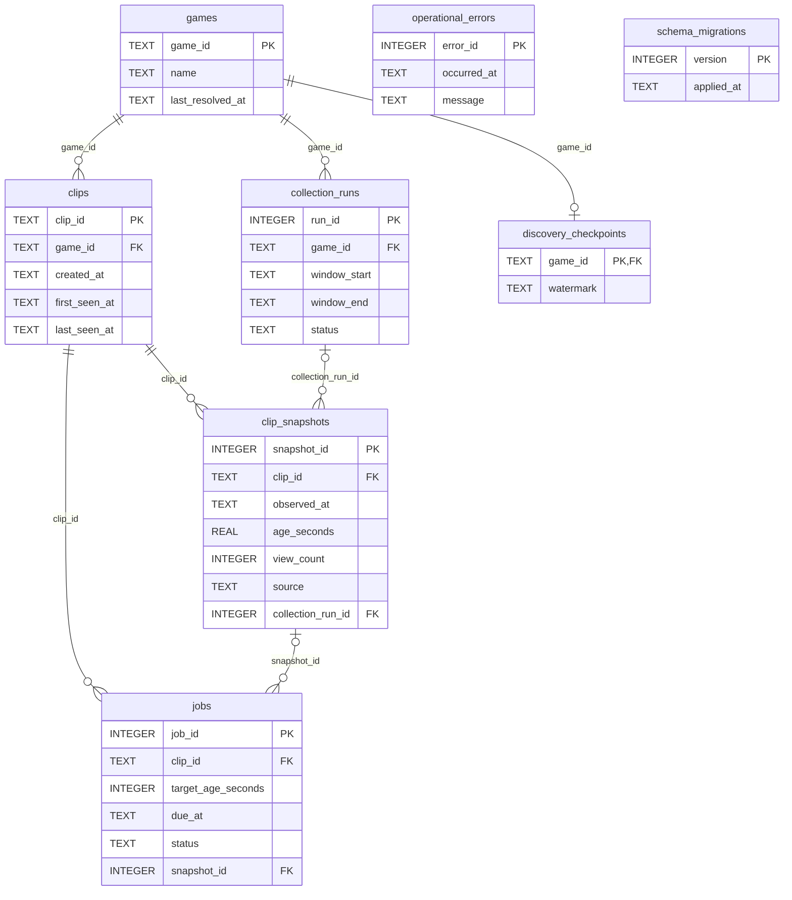

# 12–14. SQLite, integrità e recupero

[Indice](00-INDEX.md) · [Raccolta](05-TWITCH-AND-COLLECTION.md) · [Operazioni](07-INFRASTRUCTURE.md) · [Funzioni storage](04-CODE-WALKTHROUGH/02-STORAGE.md)

## 12. Dal file allo schema relazionale

SQLite è una libreria incorporata. Le query SQL girano nel processo che apre il file. Il database consente di imporre chiavi, collegare osservazioni a clip e job, e confermare operazioni insieme. A differenza di una lista in memoria conserva il lavoro fra riavvii. A differenza di una raccolta di CSV rende atomica una sequenza “append snapshot e completa job”. In SQLite `TEXT`, `INTEGER` e `REAL` indicano affinità di tipo. I vincoli e il parsing lato Python fanno parte della validazione effettiva. Le date sono testi ISO 8601 UTC con sei cifre frazionarie e `Z` quando scritte dall'applicazione. `parse_utc` accetta altri offset espliciti e normalizza. Ordini e intervalli SQL testuali sfruttano il formato canonico uniforme. [DDL e helper](../../src/viralclip/storage/database.py#L9)

Nel catalogo seguente `!` indica un vincolo `NOT NULL` dichiarato. Le `INTEGER PRIMARY KEY` sono identificatori/rowid. Gli altri PK sono identificatori testuali o versione. Le colonne citate come aggiunte appartengono alla migrazione v2.

| Tabella e uso | Colonne, chiavi e vincoli | Accessi significativi |
| --- | --- | --- |
| `schema_migrations`, registro schema | `version INTEGER PK`, `applied_at TEXT!`. Creata prima degli script. | `migrate` legge max e inserisce versione con DDL. Preflight deployment, GTA VI e Windows controllano la successione 1,2. Builder e verifiche leggono la versione. |
| `games`, categoria conosciuta | `game_id TEXT PK`, `name TEXT!`, `last_resolved_at TEXT!`. Nome privo di unique. | `upsert_game/cached_game` e `collect_cycle`. Health raggruppa, backup verifica un solo ID quando richiesto. |
| `clips`, identità e metadati correnti | `clip_id TEXT PK`, `game_id TEXT! FK games`, `broadcaster_id TEXT`, `broadcaster_name TEXT`, `creator_id TEXT`, `title TEXT`, `url TEXT`, `created_at TEXT!`, `first_seen_at TEXT!`, `duration_seconds REAL`, `language TEXT`, `status TEXT`, `last_seen_at TEXT!`. Indice `clips_game_created_idx(game_id, created_at)`. | `record_clip` conserva creazione e prima vista, aggiorna il resto e scrive `status=NULL`. Refresh usa creazione. Dataset filtra creazione e categoria, usa broadcaster solo per audit. |
| `clip_snapshots`, misure storiche | `snapshot_id INTEGER PK`, `clip_id TEXT! FK clips`, `observed_at TEXT!`, `age_seconds REAL!`, `view_count INTEGER!`, `source TEXT! CHECK discovery/scheduled`, `target_age_seconds INTEGER`, `collection_run_id INTEGER FK collection_runs`. Unique `(clip_id, observed_at, source)`. Indice `snapshots_clip_observed_idx(clip_id, observed_at)`. Trigger abort su UPDATE e DELETE. | `record_clip` inserisce discovery con run ID e target nullo. `add_scheduled_snapshot` lega uno o più job, run nullo. Health, audit, backup e dataset leggono. |
| `jobs`, lavoro durevole | `job_id INTEGER PK`, `clip_id TEXT! FK clips`, `job_type TEXT! DEFAULT view_snapshot`, `target_age_seconds INTEGER!`, `due_at TEXT!`, `status TEXT! CHECK pending/running/completed/missed/failed/unavailable`, `attempts INTEGER! DEFAULT 0`, `last_error TEXT`, `completed_at TEXT`, `snapshot_id INTEGER FK clip_snapshots` (v2), `retry_at TEXT` (v2). Unique `(clip_id, job_type, target_age_seconds)`. Indice `jobs_due_idx(status, due_at)`. | Creazione alla prima clip, `due_jobs`, `start_jobs`, `finish_jobs`, `add_scheduled_snapshot`, `recover_running_jobs`. Metriche e link 24h sono letti da health, backup, builder e audit. |
| `collection_runs`, audit discovery | `run_id INTEGER PK`, `game_id TEXT! FK games`, `window_start TEXT!`, `window_end TEXT!`, `started_at TEXT!`, `finished_at TEXT`, `request_count INTEGER! DEFAULT 0`, `pages_seen INTEGER! DEFAULT 0`, `clips_seen INTEGER! DEFAULT 0`, `new_clips INTEGER! DEFAULT 0`, `status TEXT!`, `potentially_truncated INTEGER! DEFAULT 0`, `error_summary TEXT`, `unique_clips INTEGER! DEFAULT 0` (v2). Indice `runs_finished_idx(finished_at)`. | `create_run/finish_run/recover_running_jobs`. `status` e `health` leggono successo e gap. Backup verifica categoria e segnali di discovery. |
| `discovery_checkpoints`, posizione per gioco | `game_id TEXT PK/FK games`, `watermark TEXT!`. | `_whole_minute_window` legge. `update_watermark` fa upsert bootstrap o fine completata. Health e audit calcolano staleness. |
| `operational_errors`, errori locali persistiti | `error_id INTEGER PK`, `occurred_at TEXT!`, `message TEXT!`. Nessuna relazione dichiarata. | `collect_cycle` e CLI possono accodare errori. `status` mostra ultimo messaggio. `health` restituisce numero e categorie sanificate. |

Esempio sintetico. Tutti i timestamp sotto sono UTC, abbreviati per leggibilità. I cinque job esistono insieme anche se la tabella campione ne mostra uno solo. Il gioco qui è un'identità fittizia.

| Tabella | Riga rappresentativa |
| --- | --- |
| `schema_migrations` | `version=2, applied_at=2026-11-20T13:45:00.000000Z` |
| `games` | `game_id="42", name="Gioco di prova", last_resolved_at=14:05` |
| `clips` | `clip_id="demo-a", game_id="42", created_at=14:00, first_seen_at=14:05:02, last_seen_at=14:05:02, duration_seconds=23.5, language="it"` |
| `collection_runs` | `run_id=8, game_id="42", window_start=13:35, window_end=14:05, started_at=14:05:01, finished_at=14:05:03, request_count=1, pages_seen=1, clips_seen=1, unique_clips=1, new_clips=1, status="completed"` |
| `clip_snapshots` | `snapshot_id=101, clip_id="demo-a", observed_at=14:05:02, age_seconds=302, view_count=12, source="discovery", collection_run_id=8`. Una misura separata `102` alle 14:10:03 ha `age_seconds=603, view_count=18, source="scheduled", target_age_seconds=600`. |
| `jobs` | `job_id=501, clip_id="demo-a", job_type="view_snapshot", target_age_seconds=600, due_at=14:10, status="completed", attempts=1, completed_at=14:10:03, snapshot_id=102` |
| `discovery_checkpoints` | `game_id="42", watermark=14:05` |
| `operational_errors` | Eventuale riga successiva `error_id=4, occurred_at=14:15, message="Twitch API network request failed after retries"`. |

[Schema, vincoli e query](../../src/viralclip/storage/database.py) · [Builder](../../src/viralclip/dataset.py) · [Health](../../src/viralclip/storage/health.py)

## 13. Che cosa significa confermare una misura

- **INSERT** crea una riga. **UPDATE** modifica una riga. **SELECT** legge. `record_clip` combina un `INSERT … ON CONFLICT DO UPDATE` per la clip, `INSERT OR IGNORE` per lo snapshot e per i job iniziali. La PK definisce la stessa clip anche se ricompare da più pagine.
- Una **transazione** raggruppa operazioni. `transaction` usa il context manager della connessione per commit in uscita normale e rollback su eccezione. Una misura confermata rimane se un'altra clip fallisce. La prima vista, i job della prima clip e il suo primo snapshot condividono il commit. Snapshot scheduled e aggiornamento dei suoi job condividono un'altra transazione. Mettere running avviene prima e separatamente, così un'interruzione lascia traccia recuperabile.
- **WAL**, write-ahead log, permette a SQLite di registrare commit in un file laterale prima del trasferimento delle pagine al DB. I reader possono vedere una generazione consistente mentre il writer avanza. `Database` chiede WAL, abilita FK, usa timeout e busy timeout di 30 s. `health` e `dataset` aprono `mode=ro`, impostano `query_only` e leggono in una transazione. Il lock di file OS è un coordinamento ulteriore a livello collector. Il path risolto determina il file `.collector.lock`, con byte lock Windows o flock Unix. Apertura, PRAGMA e migrazioni avvengono prima dell'acquisizione del lock del collector. `status` percorre quella strada writer. I lettori ordinari non acquisiscono il lock.
- Il **checkpoint WAL** riversa pagine dal log nel file principale. Il **checkpoint discovery** è invece un timestamp di copertura API e occupa una riga. Un'app può avere un checkpoint discovery recente e una WAL molto grande, per esempio se reader lunghi ne impediscono la compattazione.
- Gli **indici** velocizzano accessi per gioco/data, clip/ora, stato/scadenza e finish run. Occupano spazio e vanno aggiornati durante la scrittura. Il crawler non impone una durata massima della storia. La crescita di dati e indici dipende da clip, pagine sovrapposte e snapshot.
- La **migrazione** v1 crea relazioni e trigger. La v2 aggiunge `jobs.snapshot_id`, `jobs.retry_at` e `collection_runs.unique_clips`. Ogni script e il record di versione sono in un `BEGIN IMMEDIATE` con rollback su errore SQLite. Le righe vecchie mantengono valori misurati. I link precedenti non vengono ricostruiti dalla migrazione e il nuovo conteggio unico parte da zero. Un backup o replay può quindi rilevare che uno storico precedente non possiede provenance sufficiente.
- L'**integrità referenziale** controlla che un FK non nullo punti a una riga esistente. Un FK verso snapshot esistente non assicura che la clip coincida o che data e target siano corretti. `validate` e il builder applicano i controlli semantici ai propri contratti. SQLite permette anche alla stessa clip e istante una riga discovery e una scheduled, essendo la sorgente parte della chiave. Il builder deduplica invece per clip e istante.
- L'**idempotenza** qui riguarda chiavi e scritture retry-safe. Rielaborare la stessa chiave snapshot usa la riga esistente. Eseguire il giorno dopo una vera nuova misura crea una nuova riga. Rifare una query di discovery è quindi intenzionalmente osservabile senza duplicare l'identità o i cinque job.

[Test atomicità e migrazione](../../tests/test_audit.py) · [Test append-only e job](../../tests/test_collector.py) · [Limiti DB](10-TESTING-AND-RELIABILITY.md)

## 14. Interruzione, backup e ripristino

Quando il processo muore, SQLite conserva commit completi e il kernel rilascia il lock. Un run rimasto running perde il contesto HTTP in memoria e viene marcato error al prossimo proprietario. Un job running torna pending se ha meno di tre tentativi. La combinazione fra checkpoint persistito e lookback recupera opportunisticamente quanto Helix rende disponibile. Nessun replay recupera una vecchia misura. Il [caso D](13-END-TO-END-EXAMPLES.md#d-riavvio-con-job-pendenti) rende visibili queste transizioni. [Recovery](../../src/viralclip/storage/database.py) · [Blackout osservato](../PROJECT_HISTORY.md#2026-11-17-read-only-real-power-outage-recovery-audit)

Per fare una copia live con WAL si usano le API online SQLite. `online_copy` apre il source RO e riserva un file nuovo, copia 128 pagine per passo e forza modalità DELETE sul target per poterlo trasferire come file autonomo. Il controllo progress callback usa una deadline di 60 secondi, verificata durante la copia. `validate` esegue `integrity_check`, `foreign_key_check`, verifica i link dei job, gli snapshot scheduled orfani, i cinque target per clip, e raccoglie metriche. `backup_and_verify` ricopia la copia in una directory temporanea isolata e confronta le metriche dopo nuova validazione. È una prova di leggibilità e coerenza del backup. Un restore operativo su un nuovo host richiede prove ulteriori. [Helper SQLite](../../src/viralclip/storage/backup.py) · [Test WAL e link](../../tests/test_backup.py)

Il **manifest** è un documento JSON d'inventario. Registra byte, SHA-256 del file, metriche e raggruppamento dei job outstanding. La versione 2 aggiunge l'ID approvato. Il digest verifica identità dei byte rispetto al manifest di riferimento, mentre la validazione semantica verifica che il DB rappresenti il gioco atteso e il sistema di trasferimento deve custodire il manifest indipendentemente. Per un backup game-pinned servono esattamente una categoria in `games`, righe coerenti nelle altre tabelle di categoria, e almeno una clip o una discovery completa con una pagina. Una categoria registrata senza queste prove è solo un seed. Il formato legacy v1 è ancora accettato se i dati stabiliscono l'identità richiesta. [Manifest e verifica](../../src/viralclip/deployment.py) · [Restore incrociato](../../tests/test_operations.py)

La **perdita massima** dipende dal Recovery Point Objective (RPO), cioè l'intervallo massimo di dati che si è disposti a perdere. Con timer giornaliero effettivamente attivo, copie riuscite e offsite ripristinabile, il recovery point disponibile in condizioni ordinarie risale indicativamente all'ultima copia, fino a circa un intervallo giornaliero più ritardi di esecuzione. `now` nel marker è l'orario richiesto a inizio job, non certifica un'ora atomica identica di snapshot e upload. L'ultima osservazione inclusa e i job outstanding sono indizi migliori. Upload mancati e timer assenti possono allungare indefinitamente la perdita teorica. L'RPO reale, il tempo di ripristino e la resilienza a perdita VPS sono **UNKNOWN** nella sessione attuale. [Timer e gate](07-INFRASTRUCTURE.md) · [Evidenza e lacune](11-CURRENT-STATUS.md)
