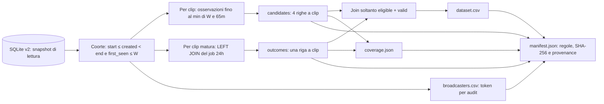

# 18–20. Dataset point-in-time, feature e label

[Indice](00-INDEX.md) · [Schema](06-DATABASE.md) · [Ranking](09-MACHINE-LEARNING.md) · [Schede ricerca](04-CODE-WALKTHROUGH/03-RESEARCH.md)

## 18. Congelare una coorte osservabile

Una coorte è l'insieme di clip a cui si applica la domanda. Per esempio, si possono usare quelle del gioco fittizio `42` create fra mezzanotte e il giorno successivo. Il **watermark di ricerca** è il limite temporale dell'evidenza disponibile per l'estrazione. È il massimo `observed_at` di tutto il database per default. Se viene fornito un valore, deve precedere o eguagliare quel massimo. Il watermark di ricerca è indipendente dai checkpoint di discovery per categoria.

1. La CLI converte gli argomenti ISO con offset in UTC, accetta filtri `--game-id` ripetibili, watermark esplicito e uno o più blackout facoltativi `--outage START END`. `Selection` conserva questi parametri. Le date sono intervalli di creazione inclusivo/esclusivo. Ingresso v2 richiesto, in URI `mode=ro` più `query_only` e transazione singola.
2. `read_source` legge la versione, massimo timestamp e massimo snapshot ID. «Massimo ID al read» e «tempo al watermark» sono metadati differenti. Filtra `created_at >= start`, `created_at < end`, `first_seen_at <= W` e, opzionalmente, ID gioco. L'ordine delle clip è `(created_at, clip_id)`.
3. Per clip legge misure fra `max(created, first_seen)` e `min(W, created+65m)` inclusi, ordinate per tempo e ID. Non filtra discovery/scheduled e non ricampiona. Fino al cutoff `candidate` deduplica per istante con l'ID più piccolo. Il timestamp è quello della misura registrata dal collector.
4. Ogni clip produce righe a 30, 35, 60 e 65 minuti. `cutoff_immature` se `prediction_at > W`, altrimenti `late_discovery` se `first_seen > prediction_at`. Con scoperta in tempo e zero misure eligibili produce `missing_observations`. Con almeno una produce `eligible`, anche in presenza di blackout annotato. Misure con stesso istante non creano due punti per la crescita.
5. La maturità determina se il builder interroga il job 24h e lo snapshot collegato. Outcome e feature sono calcolati separatamente. Il join conserva solo eligible ∩ valid. La stessa clip può avere quattro righe, ma quattro righe dello stesso ID non sono quattro osservazioni indipendenti del risultato.
6. `ignored_output` risolve il path, esige una directory nuova e accettata da `git check-ignore`. `extract` usa creazione esclusiva e scrive i cinque artefatti prima del manifest. Un'interruzione può lasciare una directory parziale senza manifest. SHA-256 consente di rilevare byte modificati rispetto al riferimento. La determinazione delle misure è ripetibile sullo stesso stato DB, stessi limiti e versione. Un watermark da solo non ricrea commit storici, metadati correnti o stato passato dei job.

| Artefatto | Chiave e significato |
| --- | --- |
| `candidates.csv` | `(clip_id, cutoff_minutes)`, gioco, creazione, predizione, status feature, esposizione blackout, primi/ultimi timestamp, ID snapshot concatenati con barra verticale, 11 feature. |
| `outcomes.csv` | Una riga per clip, stato e, se valid, ID job/snapshot, orario, età e conteggio. |
| `dataset.csv` | Candidate eligible unito ai campi outcome valid. Blank rappresenta null CSV. Anche una riga valida può mancare della crescita. |
| `broadcasters.csv` | ID clip e SHA-256 deterministico di prefisso più broadcaster ID se presente. Aggiunto in 2a.2 per audit di concentrazione, fuori dalle feature. È pseudonimizzazione locale e conserva uguaglianza attraverso estrazioni. |
| `coverage.json` | Clip uniche, stati outcome, conteggi maturi, cutoff, almeno due osservazioni, freschezza ≤300 s, crescita assente, concentrazione e blackout. |
| `manifest.json` | Versione estrazione `2a.2`, schema, watermark e massimi letti, intervalli, giochi, colonne, regole, provenance, SHA-256 degli altri cinque file. |

Il flag `outage_overlap` indica intersezione stretta fra periodo dalla creazione alla previsione e blackout dichiarato. Un rapporto aggiuntivo conta clip con target nominale 10/30/60 strettamente dentro il blackout e suddivide per prima scoperta prima, dentro o dopo il gap. Il blackout è un'annotazione, quindi i conteggi possono ancora includere clip esposte. [Builder](../../src/viralclip/dataset.py) · [Guida dataset](../POINT_IN_TIME_DATASET.md)

### Perché quattro cutoff

I cutoff di 30m e 60m corrispondono alla domanda di prodotto a quei tempi esatti. 35m e 65m misurano la sensibilità alla latenza di campionamento e concedono più tempo per rilevare le osservazioni attorno a 30m e 60m. Aspettare cinque minuti può aumentare copertura e freschezza. In compenso la decisione arriva più tardi e il confronto deve distinguere differenze di popolazione da differenze di score. Per questo il replay riporta popolazioni eleggibili per ciascun cutoff e popolazione matched comune. [Contratto](../POINT_IN_TIME_DATASET.md#selection-contract) · [Metodo di confronto](09-MACHINE-LEARNING.md)

| Esempio sintetico | 30m | 35m | 60m | 65m |
| --- | --- | --- | --- | --- |
| Creata 14:00, osservata 14:05:02, 14:10:03, 14:30:03, 15:00:04 | ultima 14:10:03 | ultima 14:30:03 | ultima 14:30:03 | ultima 15:00:04 |
| Prima vista 14:45 | late_discovery | late_discovery | eligible con la vista 14:45 | eligible anche con eventuale refresh 15:00:04 |
| Watermark alle 14:34 | cutoff trascorso | immaturo | immaturo | immaturo |

Il replay datato del 18 novembre trovò zero righe etichettate con misura nei cinque minuti prima di 60m nelle tre coorti analizzate. A 65m le misure fresche erano 909/909 nella prima coorte, 1.031/1.278 in quella blackout e 1.323/1.323 nella post-ripresa. La differenza misura disponibilità entro quelle finestre. La qualità del ranking richiede la prova separata M2B. [Evidenza M2A](../PROJECT_HISTORY.md#2026-11-18-milestone-2a-point-in-time-dataset-builder)

## 19. Le 11 feature implementate

Siano `t0` creazione, `s` prima scoperta, `p` cutoff assoluto, `(t1,v1)` e `(tn,vn)` prima e ultima misura eleggibile, `n` numero di istanti unici. Esempio: creazione alle 14:00, scoperta alle 14:05 con 12 view, seconda misura alle 14:23 con 48 view, target 30m. Si può avere un solo campione. In quel caso `t1=tn`, `v1=vn` e differenza/tasso sono assenti. Senza campioni i campi che li richiedono rimangono null. Il codice valorizza count=0 per late discovery e missing observations, lasciando count nullo per cutoff immature. [Calcolo candidate](../../src/viralclip/dataset.py#L168)

| Feature | Definizione ed esempio | Uso intuitivo, assenza e limite |
| --- | --- | --- |
| `first_views` | `v1 = 12`. | Popolarità alla prima lettura, che può avvenire a età diverse. Assente senza misura. |
| `latest_views` | `vn = 48`. | Migliore conteggio cumulativo osservabile fra le misure entro cutoff. Può essere stantio. |
| `log1p_first_views` | `ln(1+v1) = ln(13) ≈ 2,565`. | Comprime outlier e preserva zero come zero. Assente senza prima lettura. |
| `log1p_latest_views` | `ln(49) ≈ 3,892`. | Comprime la distribuzione verso la coda e conserva ordine per misura positiva. |
| `first_observation_age_seconds` | `t1 − t0 = 300`. | Distingue una clip vista presto da una vista tardi. |
| `latest_observation_age_seconds` | `tn − t0 = 1.380`. | Età reale da usare per comparare conteggi simili. Utile per baseline normalizzata. |
| `discovery_delay_seconds` | `s − t0 = 300`. | Proxy del processo di discovery, presente anche in missing_observations con prima vista in tempo. Sensibile alla strategia e ai blackout. |
| `staleness_seconds` | `p − tn = 420`. | Quanto manca fra ultima misura e l'istante della decisione. Ampio gap riduce informazione. |
| `observation_count` | `n = 2`. | Quantità di informazione, influenzata anche dall'overlap e dalla disponibilità API. |
| `observed_view_growth` | `vn − v1 = 36` con `n ≥ 2`. | Incremento fra due tempi reali. Può essere negativo se il contatore riportato scende. |
| `growth_views_per_minute` | `60(vn − v1)/(tn − t1) = 2`. | Tasso medio fra letture, non derivata istantanea. Un intervallo breve può renderlo volatile. |

I timestamp e gli ID sono provenance, il flag blackout è audit, gioco e clip sono chiavi. Il codice non fa imputazione, NLP sul titolo o trasformazioni apprese sulle partizioni. Con un solo punto, assegnare artificiosamente crescita zero confonderebbe una misura mancante con crescita effettiva nulla.

### Data leakage in questo progetto

Leakage è usare nell'input informazione disponibile solo dopo il momento cui si attribuisce la previsione, direttamente o attraverso la preparazione dei dati. Per una previsione alle 14:30:00, uno snapshot scheduled previsto alle 14:30 ma misurato alle 14:30:03 è un dato futuro. Usare l'etichetta 24h, usare la vista corrente del giorno dopo o usare il target nominale al posto dell'orario effettivo creerebbe lo stesso problema. Una storia broadcaster calcolata anche da clip del test o una normalizzazione appresa su tutto il corpus introdurrebbero leakage in un modello futuro.

Il builder filtra per misura effettiva e conserva i bounds. Il replay verifica nuovamente i timestamp e gestisce la maturità delle label prima dei confini di partizione. `first_seen_at` è protetto dall'upsert, mentre i metadati correnti della clip non sono una storia versionata. La disponibilità dei dati è dichiarata secondo tempo di misura. La separazione fra tempo di misura e tempo di commit non viene attestata. [Validazioni](../../src/viralclip/dataset.py) · [Embargo](../../src/viralclip/evaluation.py) · [Test temporali](../../tests/test_dataset.py)

## 20. Quando esiste una label

La quantità predetta per il primo obiettivo è il conteggio cumulativo di view a 24h osservate in una finestra operativa. Per un `created_at=t0`, la scadenza è `d=t0+24h`, il watermark minimo è `d+5m` e la finestra utile è `[d,d+5m]` inclusiva. Per esempio, a `W=d+4m` è ancora immature anche se il GET a `d+2m` è già finito. A piena maturità può diventare valid se il link è coerente.

| Stato `outcome_status` | Condizione |
| --- | --- |
| `immature` | Non è trascorso l'intero intervallo a W. |
| `missing` | Non c'è job, lo stato non è completed/unavailable, oppure il suo completamento è successivo a W. |
| `unavailable` | Job unavailable con timestamp di completamento utilizzabile e senza link. |
| `invalid_link` | Timestamp malformato, collegamento mancante o ad altra clip, sorgente errata, tempo completamento diverso da misura, scadenza sbagliata, target incompatibile, età o conteggio incoerenti, oppure unavailable con link. |
| `outside_window` | Link coerente ma orario reale precedente a `d` o successivo a `d+5m`. |
| `valid` | Job 86400 completed per la clip, misura scheduled collegata e coerente, tempo nella finestra e conteggio intero non negativo. Target snapshot nullo ammesso per raggruppamento di più job. |

Una clip a zero può essere valid con `views_24h=0`. Per un outcome assente il campo rimane vuoto. **Censura temporale** significa che una clip osservata troppo presto per il proprio orizzonte non può ancora contribuire alla misura finale. C'è anche selezione per disponibilità del record e per data di scoperta. Titoli o broadcaster rappresentati nella coda scoperta possono avere diversa probabilità di essere osservati o sopravvivere. I metric report distinguono denominatori per rilevare questi fenomeni. Crescita futura `views_24h−views_al_cutoff`, superamento di una soglia fissata dal training e breakout relativo al broadcaster costituiscono obiettivi distinti, da valutare con storia rigorosamente anteriore. Oggi la definizione sperimentale implementata di outcome resta il conteggio cumulativo linkato. [Outcome](../../src/viralclip/dataset.py) · [Specifica](../PROJECT_SPECIFICATION.md#labels-and-metrics) · [Decisioni aperte](15-DECISION-REGISTER.md)
