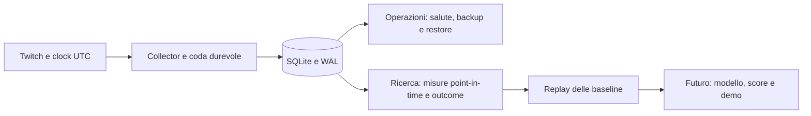

# Briefing esecutivo

[Indice completo](00-INDEX.md) · [Evidenze e stato](11-CURRENT-STATUS.md) · [Decisioni aperte](15-DECISION-REGISTER.md)

Percorso di lettura di circa 15–20 minuti, includendo diagramma, tabelle e un esercizio sulla clip guida. Per ogni passaggio puoi aprire il capitolo che scende fino a funzioni, condizioni e test.

## 1. Che cosa cerca davvero il progetto

ViralClip Radar vuole stimare quali clip Twitch avranno buoni risultati dopo 24 ore usando solo informazione disponibile nei primi minuti o entro la prima ora. Scegliere le clip con più view oggi dà una fotografia del successo già avvenuto. Prevedere richiede invece una decisione datata e una verifica successiva. Una clip molto vista può essere una buona scelta anche senza ulteriore accelerazione. Una piccola clip in rapida crescita può essere interessante pur partendo da un conteggio basso. Il progetto considera entrambi i segnali e costruisce un modo per verificare quale regola ordina meglio clip comparabili. I possibili utilizzatori sono innanzitutto chi studia o opera la raccolta e, nella futura demo, chi vuole esplorare la classifica e seguire i link originali.

Twitch conserva contenuto, distribuzione e conteggi. L'applicazione legge metadati pubblici da Helix. La view disponibile in una risposta rappresenta il conteggio visto al momento di quella richiesta. Riottenere oggi la stessa clip non permette di risalire ai conteggi delle prime ore. Perciò il primo risultato del progetto è una storia di misure raccolte mentre accadono. Il video, la distribuzione sui social, le ragioni per cui una clip si diffonde e le clip mai viste dalla discovery restano fuori da quella storia. Un esperimento preciso può stimare un ordine utile per una popolazione osservata. Un'eventuale correlazione non spiega perché un pubblico abbia scelto la clip.

Il termine viralità è quindi operativo e relativo alla domanda. Il codice implementa il conteggio cumulativo a 24 ore, misurato dentro cinque minuti dalla scadenza e collegato al job giusto. Il replay considera rilevanti le clip nella testa della distribuzione del loro gioco/giorno, includendo i pareggi. L'obiettivo di “breakout”, quanto una clip supera l'abitudine del suo canale, è un altro problema. Richiederebbe una storia di quel canale disponibile prima della predizione. La scelta di un'eventuale soglia, del cutoff primario e della metrica più importante dipenderà dalle prove sulle baseline. [Visione e storia](01-VISION-AND-HISTORY.md) · [Contratto degli esiti](08-DATA-PIPELINE.md)

## 2. I due percorsi da tenere a mente

Il **percorso operativo** produce e protegge la storia. Il collector interroga Twitch, registra clip e osservazioni, riprende i job, può essere supervisionato da systemd. Salute e backup leggono quella storia con strumenti diversi e, se installati, girano in processi distinti. Lo stato di un collector include sia il processo sia il progresso delle misure. Una verifica di systemd può affermare “è ancora in esecuzione”, e una lettura SQLite può affermare “ha prodotto nuove righe coerenti”. Il backup ha l'ulteriore domanda “posso recuperare quelle righe se perdo questo ambiente?”.

Il **percorso di ricerca** prende una copia logica coerente dei dati accumulati, esporta righe point-in-time e confronta score deterministicamente. Una feature deve essere nota quando si ipotizza di decidere. La label serve dopo, per giudicare quanto bene si è deciso. Il replay non interroga Twitch e non scrive nel DB sorgente. Produce artefatti locali privati con manifest e hash. L'attuale prodotto è una CLI per questi due percorsi. Il trainer, la scrittura di predizioni persistenti e la demo Streamlit futura dipendono da conoscenze e decisioni a valle.

Per orientarti nel codice, segui `cli.main` alla chiamata `Collector.collect_cycle`. Per le decisioni sugli orari entra in `collector/service.py`, per ciò che persiste entra in `storage/database.py`. `dataset.py` e `evaluation.py` iniziano al confine dei dati conservati. La stessa CLI può aprire in modalità diverse. `health` usa un reader, mentre `status` apre il writer capace di migrare. Per una lettura autorizzata del sistema si usa l'entry point appropriato. [Architettura e mappa chiamate](02-ARCHITECTURE.md) · [Percorso di studio](03-REPOSITORY-MAP.md#percorso-di-studio-pratico)

## 3. Segui una clip per un giorno

Supponiamo che una clip sia creata alle 14:00 UTC. Viene restituita in una risposta di discovery alle 14:05:02. Appena il collector vede che l'ID è nuovo, una singola transazione inserisce dati identitari, prima misura e cinque job a 10m, 30m, 60m, 6h, 24h dalla creazione Twitch. Prima vista e nascita della clip sono due orari separati. Il DB associa l'osservazione al run discovery e la mantiene anche se una pagina successiva ha un errore. Se la clip è rivista, `last_seen_at` può cambiare e si aggiunge una misura, mentre `first_seen_at` resta quello originario. Questa separazione aiuta a dire quando il radar avrebbe avuto conoscenza della clip.

Alle 14:10:03 il loop seleziona il job 10m dovuto, segna il tentativo, interroga l'ID e riceve un conteggio. Salva con età 603 s e ritardo 3 s. Completa il job nella transazione dello snapshot. Se due job sono diventati dovuti durante un blackout, uno snapshot reale alla ripresa può collegarli entrambi. Il target dello snapshot è nullo in quel caso, mentre il target resta dentro ciascun job. Se una clip arriva in discovery alle 14:45, il radar può osservare la clip allora e pianificare 60m, 6h e 24h. I target 10 e 30 erano già passati e vengono marcati missed. Lo storico conserva così una prova del buco, senza aggiungere una misura attribuita al passato.

Supponi ora che il refresh dei 30 minuti sia disponibile alle 14:30:03. Al momento esatto delle 14:30:00 un sistema online non potrebbe averla. Il dataset 30m la esclude. Il dataset 35m può prenderla. Allo stesso modo, 60m e 65m sono due domande diverse. Una vista a 60m+4s entra solo nel secondo esperimento. Un aumento di copertura ottenuto aspettando equivale a una decisione più tardiva. Confrontare le stesse clip nei quattro cutoff aiuta a capire se il cambiamento deriva dal tempo extra oppure dal diverso universo di clip.

Il giorno seguente una risposta alle 14:00:04 può completare il job 24h. Il replay aspetta che l'intera finestra sia trascorsa, quindi serve un watermark almeno alle 14:05. Se la clip è stata rimossa o Helix la omette, il job unavailable non acquisisce un conteggio zero. Se il servizio torna dopo otto minuti, il job può essere completato con una misura vera che il builder classifica fuori finestra. Le casistiche distinguono responsabilità del collector e validità per la ricerca. **Esercizio.** Con first_seen 14:45 e un buon refresh alle 15:00:04, quali dataset potrebbero avere feature? Quali includono proprio quel refresh? Il 60m e il 65m potrebbero essere eligibili. Solo il 65 può includere la lettura tardiva. [Otto scenari](13-END-TO-END-EXAMPLES.md) · [Scheduler e tentativi](05-TWITCH-AND-COLLECTION.md#10-scheduler-durevole)

## 4. Perché il collector può avanzare anche con copertura incompleta

La discovery usa finestre al minuto UTC, di default una ricerca nuova ogni cinque minuti. Il lookback e il checkpoint permettono sovrapposizioni e ripresa. Il cursore chiede la pagina seguente. Helix per categoria ordina i risultati per view count. Ciò favorisce la visibilità delle clip più viste quando la finestra è satura. Il collector marca indizi di saturazione, può suddividere e ha un budget finito. Un run completo significa che la ricerca prevista ha concluso il percorso previsto senza flag residui. Il punto di copertura resta indietro se non si è potuto terminare. Un run vuoto può essere completo. La frazione di clip Twitch mai ricevute è sconosciuta.

I job di refresh hanno priorità fra momenti di discovery e prima di ciascuna pagina. Le operazioni avvengono nello stesso processo e una rete lenta o un'attesa di rate limit possono comunque ritardarlo. La coda distingue un fallimento HTTP, l'assenza di un ID in una risposta valida, la scadenza persa prima della prima vista e una misura effettivamente ottenuta. È possibile vedere volumi crescenti e al contempo un peggioramento delle latenze. Per la ricerca, molti snapshot sono utili solo se soddisfano gli istanti e i legami del relativo esperimento.

La protezione operativa usa SQLite e WAL. Il motore documenta commit e consente a reader e writer di progredire con viste coerenti. Un file lock coordina il collector. Un arresto fa perdere ciò che non è stato confermato, non quello che è rimasto in SQLite. Il nuovo processo prende il lock, riprende job running con tentativi residui e usa il checkpoint persistito. Il backup usa l'API SQLite per catturare i commit visibili, compresi quelli nel WAL. Copiare solo il file principale può omettere pagine già confermate. Una copia indipendente è verificata sia a livello di byte sia di relazioni, giochi e osservazioni. [Discovery](05-TWITCH-AND-COLLECTION.md) · [Integrità e recupero](06-DATABASE.md)

## 5. Che cosa significa “funziona in produzione”

Una copia del sorgente dichiara il disegno. Una suite mostra che, a input controllati, l'implementazione ha il comportamento atteso. Un processo osservato mostra che una sua revisione, se dimostrata, opera in un ambiente e un intervallo. Per OVH oggi manca ancora questa catena completa. Nei campioni attribuiti all'operatore del 19 novembre entrambi i collector avanzavano, gli ID erano coerenti, i PID erano stabili e distinti. I campioni durano circa quattro minuti. La nuova fase 0 richiede almeno sei minuti dopo A e un inventario delle schedulazioni. Nei campioni GTA V partiva al boot e GTA VI risultava disabilitato al boot. Le otto unità operations attese erano assenti. Questi fatti si riferiscono alla finestra registrata. La situazione odierna è **UNKNOWN**.

GTA V e GTA VI usano lo stesso schema e lo stesso collector, ma hanno account, service, configurazione, path, processi, coda, WAL, log e backup separati nel deployment dichiarato. V ha ID 32982 e VI 1867279146. Il secondo ID è stato storicamente verificato per nome e reverse lookup. Avere due file localmente non basta a garantire che ogni PID tenga il file giusto. L'inventario verifica path, device/inode, account, versione, record per categoria e avanzamento nel tempo. I servizi di backup e monitor sono altri processi. Un esito degradato del primo gioco deve lasciare all'altro la possibilità di segnalare il proprio esito.

Un backup “esistente” è solo il primo passo. Il manifest e il digest dicono se si tratta della copia esatta. Lo schema, le chiavi, i job e l'ID indipendente dicono se quella copia ha un contenuto utile per il gioco richiesto. Due profili Restic hanno bisogno di scope distinti perché condividono selettori storici di host e tag. Il monitor misura stato, coda, latenze, disco e freschezza dei marker. La consegna di un heartbeat, il funzionamento del timer, una recovery dopo reboot e una prova di restore fuori VPS sono evidenze distinte. M1 si chiude con la sequenza dei gate del runbook. La sessione documentale ha confermato 159 test e sette controlli strict locali, senza osservare il VPS. [Infrastruttura](07-INFRASTRUCTURE.md) · [Matrici](10-TESTING-AND-RELIABILITY.md) · [Stato](11-CURRENT-STATUS.md)

## 6. Come si arriva a un risultato di ricerca

L'estrazione seleziona clip di un gioco o gruppo di giochi con orari di creazione in un intervallo. Congela un **watermark**, tipicamente il timestamp dell'ultima misura salvata. Per ogni clip scrive quattro candidati e un outcome. Gli 11 input numerici includono prima e ultima vista, logaritmi, età effettive, ritardo discovery, staleness, numero punti e crescita. Con due misure 12 → 48 a distanza di 18 minuti, la crescita osservata è 36 e la velocità media 2/minuto. Con una misura la velocità rimane vuota. I file conservano anche le chiavi che permettono di sapere quali misure e quale job hanno prodotto i numeri.

Una previsione registrata alle 14:30 deve usare solo quello che era osservato alle 14:30. Il leakage più facile da commettere è usare una misura chiamata “30 minuti” come feature senza controllarne l'orario. Un altro è mischiare righe dello stesso clip ID in training e test. Il builder misura i timestamp reali e il replay assegna gli split per creazione e verifica quando sono maturati gli outcome. La tecnologia ha un confine esplicito: SQLite registra il tempo di misura dichiarato dal collector, ma non un timestamp indipendente del commit e non tiene versioni dei metadati della clip. Un manifest hash-valid identifica gli artefatti e le regole. Non dimostra che l'intera popolazione Twitch sia rappresentata o quale futuro sarebbe stato osservato durante un blackout.

Le regole già implementate ordinano per ultima vista, crescita, crescita al minuto o vista divisa per età della misura. Il replay confronta le liste rispetto agli esiti a 24h. Precision@K esprime la quota di suggerimenti rilevanti. Recall@K la quota dei rilevanti del pool effettivamente presi. NDCG premia portare label alte vicino alla cima. Un giorno utile per questo replay richiede copertura completa dell'intervallo di creazione, watermark e scadenze maturi, almeno dieci clip matched e variazione degli outcome. Ci vogliono almeno due date rankable in ciascuno dei tre split dopo embargo. Le date complete, non il numero grezzo di righe esportate, governano il passaggio.

M2A ha prodotto replay con misure reali e outcome, e M2B ha provato il meccanismo con migliaia di clip. Il replay del 18 novembre aveva 3.344 matched ma tutti da un singolo giorno parziale. Ha correttamente restituito `INSUFFICIENT DATA`, senza score. L'audit locale non è una rilettura degli artefatti privati di quella produzione. Il passo di ricerca è raccogliere abbastanza giorni, dichiarare il protocollo, confrontare baseline e copertura, poi progettare M3. Logistica e LightGBM sono proposte di specifica. La prima attribuisce un punteggio ai segnali tramite pesi e una funzione logistica; il secondo combina alberi successivi per correggere gli errori. La metrica, la qualità, il modello selezionato e l'eventuale probabilità calibrata sono ancora decisioni da verificare. [Feature, leakage e label](08-DATA-PIPELINE.md) · [Baseline e futuro ML](09-MACHINE-LEARNING.md)

## 7. A che punto siamo e quali prove servono

**M0 è GO storico** dal 18 novembre. Il collector ha prodotto storia reale, e la coorte post-interruzione ha 1.323 esiti validi collegati dopo osservazioni nella prima ora. Un esito così circoscritto dimostra il flusso. M1A e M1B hanno codice, test e prove offline e un riscontro Windows per health e telemetria. **M1 unattended è ancora aperta** e riparte dalla fase 0 del runbook. **M2A e M2B sono implementate** con evidenza reale di estrazione e insufficienza di giorni nell'ultimo replay disponibile. **M3 e M4** restano lavoro futuro per training e demo, con parti di workflow e documentazione già presenti. Il registro distingue P0–P2 sul workflow dai numeri di rollout M1. È importante non promuovere lo stato della produzione in base a esiti di un lavoro sul packaging o alla sola presenza del codice.

Le decisioni immediate hanno due assi. Sul servizio, autorizzare eventualmente fase 0, stabilire le prove e decidere più avanti policy di boot, backup e alert. Sulla ricerca, definire quando un dataset è abbastanza informativo, con quali giochi e cutoff, e quali sono la misura e il risultato principale. Modello e interfaccia vengono dopo. Una demo può mostrare tutti i passaggi usando dati sintetici chiaramente identificati. Gli eventuali dati raccolti e i modelli reali hanno un confine privato e le condizioni di pubblicazione richiedono verifica distinta.

### Come leggere tre risultati senza confonderli

| Risultato | Risposta che permette di dare | Evidenza ancora necessaria |
| --- | --- | --- |
| Una clip con job 30m `completed` | Il collector ha ottenuto una misura e ha collegato il record al job. Nell'esempio il conteggio è arrivato alle 14:30:03. | Per descriverla come feature a 30m serve una misura effettivamente disponibile entro le 14:30:00. Altrimenti si può discutere separatamente la previsione a 35m. |
| Entrambi i processi avanzano per quattro minuti su OVH | Il campione storico attesta che discovery e registrazione procedevano per i due giochi. | Per accettare M1 servono gli altri gate del runbook, compresi ancore offsite, restore, monitor e prove di avvio automatico. |
| 3.344 clip matched in un replay | Per quelle clip si possono confrontare quattro set di feature riferiti agli stessi ID con label valide. | Per stimare il ranking sul futuro serve che più giorni interi maturino in tre periodi temporali distinti. Il replay storico era sotto quel requisito. |

Immagina di leggere un futuro report con più feature a 65m, ma con il ranking alla stessa qualità sul pool matched. La copertura più alta sarebbe un beneficio pratico se l'utente accetta di decidere cinque minuti dopo. I numeri, da soli, non dimostrerebbero che arrivare a 65m rende possibile ordinare meglio le clip che erano già eleggibili a 60m. Per decidere servirebbero l'effetto sul pool specifico, la stabilità su più giorni, la diversa età alla decisione e la copertura delle label. È uno dei motivi per cui il codice conserva più contatori del semplice numero di righe esportate. [Gate e popolazioni](09-MACHINE-LEARNING.md) · [Prove e copertura](10-TESTING-AND-RELIABILITY.md)

Per diventare autonomo sulla base tecnica, ripeti tre percorsi sul sorgente. Prima, prendi un ID dal GET e ritrova in SQL la prima misura e i cinque job. Secondo, prendi un snapshot a età effettiva e decidi a quali cutoff e outcome partecipi. Terzo, prendi un'accettazione del runbook e ricostruisci quale evidenza proviene da unit, schema, prova offline o campione datato. Nel [registro](15-DECISION-REGISTER.md) trovi i trade-off per deliberare. Nella [roadmap](12-ROADMAP.md) trovi le dipendenze e i gate. L'[inventario](03-REPOSITORY-MAP.md) e le [schede di codice](04-CODE-WALKTHROUGH/00-GUIDE.md) permettono di fare gli stessi percorsi a partire da qualunque file.
